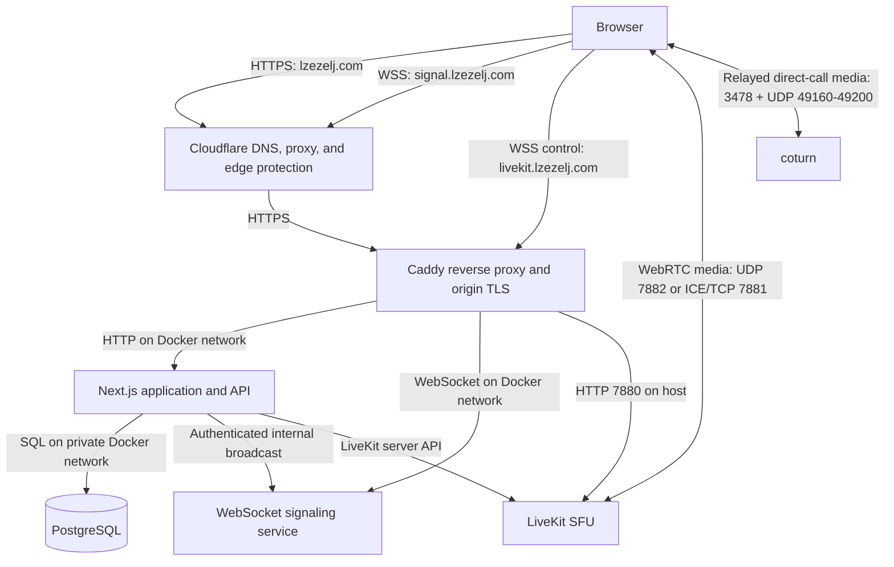

# LC architecture

LC is a self-hosted, invitation-only communication application built as a
portfolio project. It supports persistent text chat, direct two-person WebRTC
calls, and multi-person calls through a LiveKit selective forwarding unit
(SFU).

This overview describes the current system and maps tasks to focused documents.
Read it first, then load only the relevant topics and their necessary dependencies.
Current limitations and possible scaling paths live in
[infrastructure](docs/architecture/infrastructure.md#current-limitations-and-trade-offs);
the single-server design targets a small portfolio deployment.
For an explanation of the major choices, alternatives and learning exercises,
see [LEARNING_GUIDE.md](LEARNING_GUIDE.md).

## Goals

- Let one owner and a server-managed allowlist of Google accounts sign in.
- Let the owner create temporary demo accounts and invite them to a server.
- Persist servers, channels, memberships, and text messages, with non-owner
  accounts limited to three servers they create.
- Deliver new messages and voice presence in real time.
- Allow direct text conversations between friends or shared-server accounts,
  retaining existing message history independently of friendship. Direct calls
  still require accepted friendship; see [messaging](docs/architecture/messaging.md#direct-conversations-and-friendship).
- Support direct two-person voice/video with native WebRTC.
- Support group voice/video without requiring every participant to upload one
  stream per recipient.
- Keep the database, application ports, and internal service credentials off
  the public network.

## High-level topology

The application and signaling hostnames are proxied by Cloudflare. The LiveKit
hostname is DNS-only because WebRTC needs direct connectivity to the media
server. Caddy still provides HTTPS for LiveKit's WebSocket control connection;
the high-volume media path uses LiveKit's dedicated RTC ports.

## Reading map

| Task or question | Read |
| --- | --- |
| Login, roles, sessions, demo credentials, account deletion | [Authentication and authorization](docs/architecture/authentication.md) |
| Owner dashboard, account/server administration and admin log | [Application administration](docs/architecture/admin.md) |
| Schema, migrations and persistence ownership | [Database and persistence](docs/architecture/database.md) |
| Chat, drafts, edits, search, attachments, reactions and history | [Messaging and conversation history](docs/architecture/messaging.md) |
| Signaling, direct/group call flow, handoff and reconnects | [Voice sessions and transports](docs/architecture/voice-and-media.md) |
| Camera/screen capture, mirroring, devices and microphone processing | [Media capture and audio processing](docs/architecture/media-and-audio.md) |
| Server/channel access, invitations, status/AFK and drag ordering | [Servers, channels and presence](docs/architecture/servers-and-presence.md) |
| Workspace navigation, profiles, settings, panels and overlays | [Workspace UI and navigation](docs/architecture/ui.md) |
| Unread/read state, mentions, notification sounds and typing | [Notifications and activity](docs/architecture/notifications.md) |
| Sound upload/storage, playback, join sounds and quotas | [Server soundboards and join sounds](docs/architecture/soundboards.md) |
| Networking, deployment, secrets, rate limits, failures and scaling | [Infrastructure, deployment and operations](docs/architecture/infrastructure.md) |
| Scheduled PostgreSQL backups, restore by date and recovery | [Database backups and restore](docs/architecture/infrastructure.md#database-backups-and-restore) |

Each topic owns its detailed behavior, data flow, limitations and validation notes.
Follow its related links when a change crosses a boundary; reading every topic is
not required. For example, a drag-handle layout fix starts with Servers and UI,
while a voice handoff change also needs Authentication and Voice sessions.
For file-level implementation details, search the linked source files rather than
expanding unrelated documentation. The [project instructions](AGENTS.md) remain
mandatory, including the product rules that apply across all topics.

## Next.js application

The client provider tree also owns account-scoped, in-memory profile/server picture
resources shared by Avatar and startup preloading; see
[UI caching](docs/architecture/ui.md#cached-navigation-and-loading) for lifetime,
authorization and memory limits.
Shared SwitchControl and SegmentedControl components own equivalent settings
selection controls; their visual and interaction contracts live in the
[UI guide](docs/architecture/ui.md#visual-rules-and-consistency).

Next.js provides the React interface and server-side API routes. Its server
responsibilities include:

- Auth.js authentication and session validation.
- Owner, server-owner, and server-membership authorization.
- Current-configured-owner account/server dashboard and admin APIs, with transactional audit history and no admin message browsing.
- Owner-authorized renaming of servers, channels, and managed demo users, plus
  authenticated self-service username changes.
- Drizzle queries and transactions.
- Creation of short-lived signaling tokens.
- Authoritative signaling permission snapshots for every socket admission and
  periodic account refresh; see [authorization](docs/architecture/authentication.md#signaling-authorization).
- Creation of room-scoped LiveKit participant tokens.
- Persistence of text messages before real-time delivery.
- Server-side LiveKit presence queries.

## Maintaining this documentation

Update the owning topic when behavior, data flow, infrastructure or limitations
change. Update this overview when topology, shared component responsibilities or
the reading map changes. Link to another topic's contract instead of copying it.
Keep source references and validation notes close to the feature they describe.
The [test guide](tests/README.md) documents test prerequisites and browser modes.
