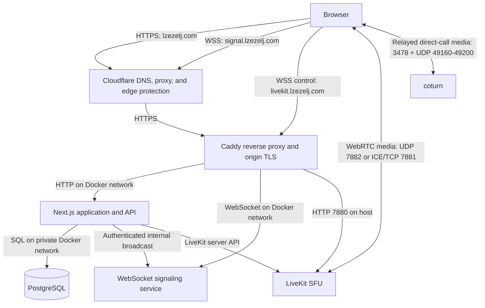
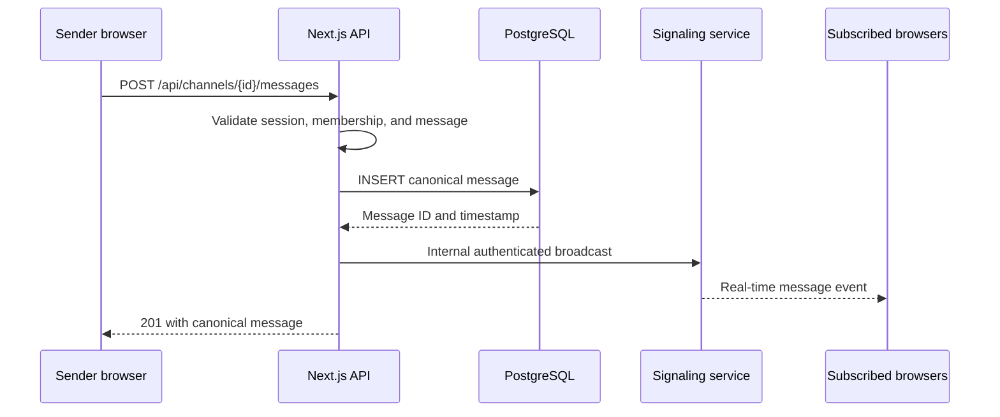
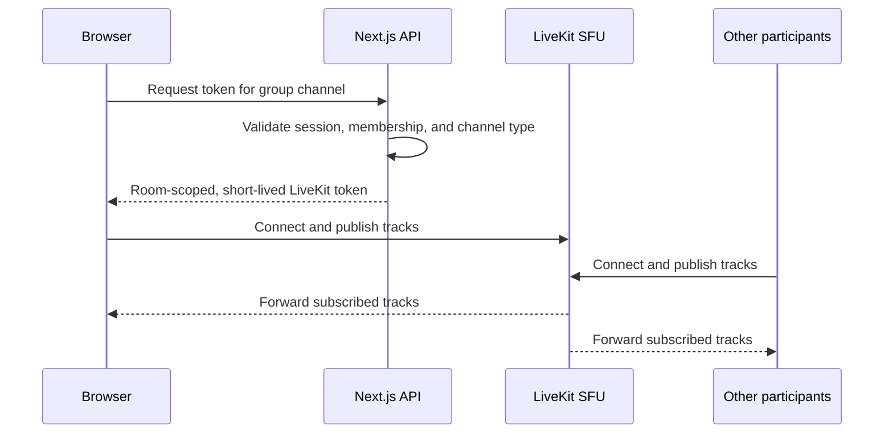

# LC architecture

LC is a self-hosted, invitation-only communication application built as a
portfolio project. It supports persistent text chat, direct two-person WebRTC
calls, and multi-person calls through a LiveKit selective forwarding unit
(SFU).

This document describes the system as it exists today. The final section calls
out limitations and possible scaling paths instead of presenting the current
single-server design as production infrastructure for a large public service.
For an explanation of the major choices, alternatives and learning exercises,
see [LEARNING_GUIDE.md](LEARNING_GUIDE.md).

## Goals

- Let one owner and a server-managed allowlist of Google accounts sign in.
- Let the owner create temporary demo accounts and invite them to a server.
- Persist servers, channels, memberships, and text messages, with non-owner
  accounts limited to three servers they create.
- Deliver new messages and voice presence in real time.
- Support direct two-person voice/video with native WebRTC.
- Support group voice/video without requiring every participant to upload one
  stream per recipient.
- Keep the database, application ports, and internal service credentials off
  the public network.

## High-level topology



The application and signaling hostnames are proxied by Cloudflare. The LiveKit
hostname is DNS-only because WebRTC needs direct connectivity to the media
server. Caddy still provides HTTPS for LiveKit's WebSocket control connection;
the high-volume media path uses LiveKit's dedicated RTC ports.

## Component responsibilities

### Browser

The browser renders the Next.js client, captures microphone/camera/screen media
after an explicit permission request, opens the authenticated signaling
WebSocket, and creates WebRTC connections.

For direct calls, browsers negotiate with each other and send media peer to
peer. For group calls, each browser publishes media to LiveKit and subscribes
to tracks selected by LiveKit.

Screen capture is requested only after a participant selects Share screen in a
connected call. A shared setup dialog offers 720p, 1080p (default), 1440p and 4K
at 30 fps before the browser's source picker. Direct capture requests the chosen
resolution, and its help tooltip explains that selecting 4K cannot add pixels
to a lower-resolution source. Audio capture is requested alongside screen video;
the browser picker and OS determine whether tab, window or system audio is
available and enabled. Shared audio capture requests stereo without echo
cancellation, noise suppression or automatic gain control. Group publication
uses a 192 kbps stereo audio preset with DTX disabled; direct audio uses a
192 kbps sender ceiling and marks captured audio as music. These requests avoid
speech processing and silence suppression changing shared content, but browser
capture, codec negotiation and network conditions still determine actual quality.
Direct calls reserve a second audio transceiver for
screen audio, separate from the microphone, and play it through a second stable
audio element in CallMediaProvider. Silent placeholders added with addTrack keep
the slots reusable while answering offers, including microphone permission
fallback; replacing or stopping a screen track preserves the microphone slot.
Group calls publish LiveKit ScreenShareAudio
and distinguish that source from microphone audio. Each viewer has a per-stream
volume/mute control at the bottom right, revealed on hover or keyboard focus;
its gain multiplies the main output volume and Deafen silences both sources.
Screen audio is audible only while its video is visible in the opened media
panel: Watch focuses that stream, and opening the joined voice channel shows
the grid. Closing the panel, hiding the tile or focusing a different video
silences that screen without stopping voice audio or capture/publication.
Local previews remain muted. Starting a share plays a short notification tone
for the sharer and connected listeners; stopping sharing plays a descending tone.
Explicit microphone mute/unmute, deafen/undeafen and camera on/off actions play
distinct short local confirmation tones through `call-sounds.ts` in both native
and LiveKit calls. Each reverse action uses the corresponding reversed tone.
These synthesized cues go directly to local output, including the deafen
confirmation, and are never published to other participants. Failed capture or
publication, reconnects and automatic microphone muting do not trigger them.
Participant camera and bordered Watch shortcuts
open the media panel, reveal and focus that participant's matching tile.
Direct calls expose the camera shortcut only while the outgoing video is a
camera; while sharing, their single video sender carries the screen instead.
Direct capture requests the chosen
maximum dimensions; group calls pass the resolution to LiveKit. Actual quality
depends on browser support, the source and available bandwidth. In direct calls
screen sharing replaces the participant's
outgoing camera track on the existing peer connection, then restores the camera
when sharing ends; the authenticated signaling socket relays any required
renegotiation and screen-presence state, but never the captured media. In group
calls the browser uses LiveKit's native screen-share publication, so camera and
screen can be published as distinct tracks and forwarded by the SFU. Closing
the browser picker stops the share and clears presence in both call types.
The call grid includes name-only tiles for participants without video. Voice
channel clicks join with that grid closed; clicking the already joined channel
opens the grid. Local camera and screen tiles start hidden; Show yourself reveals
both, and Hide yourself hides them again without changing outgoing media. Local
previews are muted; LiveKit renders screen and camera as separate tiles,
while direct calls preview the screen in the outgoing-video tile during sharing.
Starting a screen share opens the call grid, respecting local tile visibility; later
navigation can hide the grid without stopping the share. Channel renaming is
available to server owners through a channel context menu.
LiveKit camera previews select the camera publication by source, independently
of screen publication order. Leaving invalidates the active room before stopping
capture and detaching tracks; late media callbacks cannot reannounce membership.
Pending token/capture operations are discarded when their join or room is obsolete.
Each call tile can be hidden locally and restored individually from Hidden
windows. Hiding changes only rendering: media elements remain mounted, audio
continues, and publishing/presence and other participants' views are unaffected.
Tile visibility lasts for the call and uses separate camera/screen identifiers.
The Hidden windows menu and Show/Hide yourself control are hidden while a single video is focused and return
when the grid is restored.
Video overlays show actual pixel dimensions without a duplicate height label,
with transfer rate, FPS and ping below. Fullscreen targets the selected video
tile, retaining its media element and audio connection. Names, grid controls and
other overlays are hidden there; a small information button reveals stream
identity, dimensions and available network statistics on hover or keyboard focus.

The client keeps the camera resolution preference in browser storage (720p by default). Camera menus
and Voice/video settings expose the same 480p–4K choice, requesting up to that
size at 30 fps. Direct calls apply constraints to active capture; LiveKit
restarts only the camera track. Camera previews use that same preference.
Voice membership is independent from navigation. The client keeps the active
direct peer connection or LiveKit room mounted while the user visits another
server or text channel, and disconnects only when the user leaves or joins a
different voice channel. Microphone capture requests mono 48 kHz audio with
browser echo cancellation, noise suppression, and automatic gain control.
Direct-call audio is mounted in `CallMediaProvider` above the Friends/server
workspace branches. Switching those branches cannot replace the audio element;
video previews restore their stored streams after navigation. Remote previews
are muted because the persistent audio element alone plays received sound.
Fresh authenticated entry and the Friends button open the Friends list. The LC
button returns to the selected direct conversation when switching back from a
server; switching workspaces retains that selection without affecting calls.
Reloads restore the last Friends tab/conversation or server/text channel from
per-account session storage in that browser tab. Startup validates saved IDs
against current server access, accepted friends and fetched channels; stale
destinations fall back to Friends or the server's first text channel. Persistence
waits until restoration finishes so initial defaults cannot overwrite the saved
destination. This stores navigation IDs only and does not resume calls/capture
after a full reload. WorkspaceShell keeps the group-call component in a
stable sibling layer outside changing Friends/server children, so navigation
preserves the LiveKit room, capture tracks, remote audio elements and call controls.
The media grid can overlay either workspace without moving the room component.
The shared profile footer appears in both views and derives its connection label
from active direct/group voice membership, rather than the currently viewed
server or a generic signaling status. Long labels truncate with a full-text
hover title.
The sidebar footer grows only during an active call: screen sharing and
actions sit above connection status/diagnostics and disconnect, with identity,
microphone/camera controls and a separate settings menu along the bottom.
Forced group-room disconnections clear the active voice selection and call UI.
The microphone can be muted before joining, and that choice is retained across
calls during the current app session. Direct capture disables the track before
publishing; a muted group join keeps microphone capture off until unmuted.
The headphones control deafens both call playback and microphone transmission,
preserving the user's independent mute preference when undeafened. Deafen is
included in authenticated voice-presence updates for direct and group channels,
so participants see a headphones indicator alongside the muted microphone.
The viewer's own row derives mute/deafen from local controls immediately,
independently of signaling echo. The authorized LiveKit fallback snapshot
includes user IDs so this also works before signaling arrives; fallback results
cannot replace an authoritative channel snapshot already received by WebSocket.
All four participant indicators share one bordered style and centered alignment.
It is a local audio preference and does not deafen other participants. Deafen is
session-local and also closes the shared microphone gain gate, including when
capture finishes after the toggle. Group microphone updates are serialized, and
mute intent is committed before awaiting LiveKit; callback-only renders cannot
restore an older mute value. The red microphone button, processed track enable
state and published voice presence follow that same intent, including unmute.
Remote-track volume updates do not detach audio playback. Device choices are
grouped in dropdown sections, with saved input/output volume (0–100%) and output
selection. Input volume scales the gated outgoing track without changing the
voice threshold. Direct playback uses the persistent audio element's volume and
sink; group playback uses LiveKit remote-track gain and room audio-output
switching. Output selection requires browser support for media-element and
AudioContext sinks; unsupported browsers retain the system output and volume
controls. These are application audio levels, not hardware mixer controls.
The idle footer uses the same microphone/device control as a joined call.
Both microphone menus expose the same device, volume and processing-mode controls,
including before joining. The microphone and output dropdowns use the channel
sidebar width, fixed positioning and an elevated stacking layer so chat content
cannot cover them. The old restart and overall-processing actions are removed.
The full call footer appears as soon as joining starts, with Connecting to the
channel shown until room joining and initial microphone setup finish (including
receive-only fallback). Media/device actions are disabled during setup, while
Disconnect remains available; connection diagnostics appear once ready. Direct
rooms remain ready while waiting for another participant; readiness does not
depend on remote video, diagnostics, or a second participant arriving.
Channel highlighting follows the visible workspace: text channels remain
highlighted during voice-only use; opening the call grid highlights its voice
channel and clears the text highlight.
Microphone transmission passes through on-device RNNoise and a Web Audio volume
stage before WebRTC encoding. When RNNoise is active, no additional loudness gate
cuts its output: quiet speech already attenuated by the denoiser must remain
audible. Manual mute/deafen and input volume still apply. Browser fallback retains
the locally saved threshold (default -50 dBFS), 10 dB hysteresis and 350 ms release.
Direct
calls publish its output track; group calls install the gate as a LiveKit audio
processor before publication. Device changes rebuild the graph, and leaving stops
the graph and capture. The shared context requests 48 kHz for RNNoise; unsupported
sample rates, module/initialization errors and runtime processor failures retain
or reconnect browser noise suppression instead of silencing the call. RNNoise
loads only in RNNoise mode. The microphone menu and Voice & video reuse a
Raw / Browser / RNNoise selector, saved as `lc.microphoneMode`. Raw disables LC
suppression, echo cancellation, automatic gain control and the threshold gate;
input/output volume and explicit mute/deafen remain active. Browser enables
browser suppression/automatic gain and the saved transmission threshold. RNNoise
uses the neural model without an additional loudness gate, falling back to Browser
if it cannot start. Initial capture and live graph changes use the same mode.
Voice & video has an independent Echo cancellation
checkbox, saved as `lc.echoCancellation`, enabled by default. Capture constraints,
active RNNoise initialization and browser fallback all honor that preference;
changing it updates active graphs without replacing their published output.
Raw temporarily bypasses this preference and disables its checkbox; returning
to Browser or RNNoise restores the saved echo choice.
Preference events update every active microphone graph,
including the settings test, without recapturing or replacing the output track.
Storage events synchronize other tabs. Aborted/revised initialization cannot
reattach an obsolete filter after a toggle, and stopping removes these listeners.
Without a saved mode, retired preferences migrate in memory: overall processing
off becomes Raw, RNNoise off becomes Browser, otherwise RNNoise remains the default.
Saving a mode also updates legacy keys for older open tabs without changing the
independent echo preference.
Once RNNoise confirms readiness, browser noise suppression and automatic gain
control are disabled on the original track to avoid stacked denoisers and noise
amplification; echo cancellation follows its separate preference. Failures restore
browser suppression while preserving the echo choice. Original tracks and the published output track remain stable
while switching processing paths. The fallback gate is based on loudness, and RNNoise
is speech denoising rather than identification of the intended speaker: other
people's voices can remain.

`@shiguredo/rnnoise-wasm` is pinned to 2025.1.5. The public versioned GET
`/api/audio/rnnoise/2025.1.5` is generated at build time with the embedded WASM,
Apache license and upstream RNNoise notices; it contains library code and no user
audio or credentials. The hashed worklet asset imports that same-origin module.
The public, statically generated `/licenses` page includes the full upstream
RNNoise and wrapper license texts. A Licenses footer action opens it inside the
existing legal overlay without unmounting the application or active call; the
notices remain accessible independently of repository visibility. Voice & video
keeps permission access at the top, followed by an audio group (devices,
processing, echo cancellation, threshold and test) and a camera group (device,
resolution and test). Both tests retain a single shared lifecycle component.
Its private AudioWorklet realm supplies the worker marker required by the pinned
Emscripten build, buffers 128-sample quanta into 480-sample mono PCM frames and
adds 10 ms of buffering in addition to RNNoise's algorithmic delay. One engine
loads per context and each capture owns a denoise state. Readiness/cancellation
checks prevent late loading from reconnecting stopped capture. Stop releases
model state and acknowledges cleanup before its message port closes. No audio
is sent to a noise-suppression service, and no cross-origin isolation headers,
external CDN or production infrastructure changes are required.
Voice/video settings show the active RNNoise/browser/off mode, a local input
meter, automatic processed mic playback after Test microphone is selected,
and a muted camera preview. The old Hear my microphone checkbox is removed.
Playback still respects Deafen, output volume and the selected output device;
autoplay failures show an error. Tests stop and pause their own playback when stopped, when the
device changes, or when the dialog closes, without stopping an ongoing call.
Deafen changes update every active gain stage immediately rather than waiting
for its periodic level-sampling timer.
Group playback and microphone processing share the gesture-unlocked audio context.
The optional `npm run test:webrtc-browser -- --microphone` check feeds generated
audio through the actual gate in headless Edge and verifies quiet blocking,
speech-level tone passage, live threshold changes, RNNoise noise attenuation,
deafen, worklet-failure fallback and output-track cleanup. Generated noise/tone
checks do not establish subjective speech quality or background-voice isolation.
Server selection updates the visible workspace immediately. Visited servers
restore their own cached channel/member snapshots and message history in the
navigation state update, before a loading frame can paint. An account-scoped
`SessionCache` holds up to 20 server snapshots or 1 MiB of serialized metadata,
using the same bounded memory-cache implementation as conversation history.
Server/channel/access events, account changes and reconnects invalidate these
snapshots. A background effect still revalidates destination channels and members
independently; permission failures discard cached content. Unvisited servers
clear the old server's data rather than briefly displaying it under a new name.
Channel selection and history loading do not wait for members.
Loading indicators stay inside the workspace, keeping navigation and active
calls mounted. Switching again aborts obsolete list requests and ignores their
responses. Text-channel clicks clear the previous channel's visible history;
previously loaded message pages restore from the page-session cache, while an
uncached channel shows loading until its authorized history arrives.

Signaling sends protocol ping frames every 30 seconds; browsers answer pong frames
without JavaScript timers. A connection missing the next heartbeat is terminated
through normal disconnect cleanup. This prevents idle connections from remaining
silent through proxies and detects broken peers. Reconnects still invalidate
history caches to recover missed changes, but an account/conversation-scoped
snapshot keeps the currently loaded messages and loading-ready state visible.
Recovery fetches 50-message pages through the previous oldest cursor (or the end
if all history was loaded), then reconciles persisted edits/deletions with live
updates received during recovery. Denied or missing conversations clear retained
content; temporary failures leave it visible and retry on a later reconnect.
Navigation aborts recovery and rejects obsolete responses. No production proxy
timeout or infrastructure configuration was changed.

### Local participant playback and profile images

`useParticipantAudio` holds personal mute/deafen/volume choices per account and
remote user for the mounted workspace session. Voice participant context menus
expose these controls to every listener; owner-only Kick/Move remain separately
guarded in the UI and backend. Friends' notification menus include the same
playback controls, distinct from message/call notification mutes. Native calls
multiply the main output gain for microphone, screen and soundboard audio by
the participant gain. LiveKit applies it independently to each remote track and
strips the session suffix from media identities when looking up account choices.
Personal mute blocks only incoming audio; the muted person still hears the
listener. Personal deafen blocks audio in both directions between those accounts,
including soundboard and screen audio, without affecting other listeners. Native
WebRTC serializes audio sender encoding `active` changes without stopping shared
capture or renegotiating. LiveKit publisher subscription permissions deny audio
tracks to the chosen recipient while retaining video permissions; these rules are
refreshed on participant/track changes and reconnect. Permission updates run
only after LiveKit reaches `connected`; setup/reconnection retains the latest
choices without issuing premature subscription permission signals. Incoming gain applies both
choices immediately. Volume, mute and deafen remain independent. Reload/account
changes reset these temporary choices. `LocallyMuted` shows a microphone icon for
personal mute and a headphones icon for personal deafen only in the voice-channel
participant list, separately from participants' published self-mute/deafen status.
Messages, conversation headers, friends and user lists do not display these icons.

Migration `0023_voice_moderation` adds persistent, independent `voice_muted` and
`voice_deafened` flags to each server membership. The authenticated
`/api/servers/[serverId]/voice-moderation` endpoint allows members to read the
roster and only the current server owner to change another member's flags. The
transaction locks memberships, commits before updating media, then sends targeted
`voice-moderation-changed` events without invalidating visible message history.
Policies follow the member across this server's voice channels; new memberships
default off. Ownership transfer clears restrictions on the new owner. Own mic
preferences are retained underneath the enforced policy. Joins and signaling
reconnections reload policy state, including after missed events.
Channel indicators merge this saved policy over reported self state: server
mute/deafen use red icons and cannot disappear following self-undeafen presence
updates. Matching normal/personal icons are suppressed. Owner actions switch to
Server unmute/undeafen when active; server-deafened users cannot trigger the
self-undeafen action. Personal controls are centered in one row, and crowded voice
names truncate with a full-name title while the icons retain their width.

Next.js updates matching account identities in this server's LiveKit rooms and
limits fresh tokens to camera/screen video sources when server-muted/deafened,
blocking microphone, soundboard and screen audio. Server deafen additionally
sets `canSubscribe: false`: SFU enforcement blocks incoming video as well as audio.
Native peer-to-peer moderation depends on the official clients applying the
policy; a modified peer cannot be forced to stop transmitting by a central SFU.
Personal LiveKit deafen depends on the publisher honoring its subscription
permissions. Existing self-hosted token-replay limitations still apply. Failed SFU
updates return `mediaSynced: false` and show a warning; a stored choice is not
reported as proof that an unavailable SFU applied it. Real multi-account SFU
moderation still requires verification against the deployed media service.

The shared `Avatar` renders existing profile image URLs as circles with initials
on missing/failed images. Voice-channel avatars are 20px; message/friend/member
avatars are 32px (26px in the compact conversation list). Message history, search and live message responses include
`authorImage`, while current member/friend/session images take precedence in the
workspace. A known user's explicit null picture overrides stale message metadata.
External profile images use no-referrer and bypass the image optimizer.

My account groups the profile picture before display-name controls.
`ProfilePictureSettings` accepts PNG/JPEG/WebP up to 2 MiB and opens a local crop
editor with drag positioning, zoom/position sliders and a live circular preview.
Selection and cancellation do not upload. Explicit Save picture re-encodes the
chosen square to a 256px PNG; original aspect ratio is preserved within the crop.
PUT/DELETE `/api/users/me/avatar` derive the target from the session,
rate-limit updates and bound raw uploads to 512 KiB before reading them in full.
The server checks PNG signature/IHDR dimensions (maximum 512px per side), but does
not perform independent full image decoding or re-encoding. Invalid image data
cannot execute as SVG/HTML and falls back to initials if the browser cannot decode
it. Migration `0022_profile_pictures` stores one bounded bytea row per user with
replace/delete transactions, FK cleanup and a trigger clearing bytes when the
account's image is removed, including soft account deletion. Only a versioned URL
is stored in `users.image` and JWT/session metadata; bytes are not copied into
messages or tokens. Auth callbacks refresh the picture from PostgreSQL.

GET `/api/users/{userId}/avatar` requires self, accepted friendship or current
shared-server membership before returning private/no-store, PNG-only/nosniff
bytes. A targeted `profile-updated` user event updates current friend/member
metadata and invalidates server snapshots without clearing message history or
restarting calls. Other tabs of the same account also refresh session metadata.

### Conversation drafts

`useConversationDraft` keeps unsent text and selected `File` objects in the mounted
workspace's React state, keyed by channel UUID or DM peer UUID and scoped to the
signed-in account. Switching servers, channels or direct conversations restores
the matching draft immediately. Reloading/unmounting or changing accounts clears
all drafts; there is no browser-storage, cross-tab or server synchronization.
Empty drafts are removed. Attachment previews release their object URLs on
unmount and recreate them from the retained files when the conversation returns.
Successful sends clear only the original draft object, even after navigation;
newer text/files and drafts in other conversations are preserved. Failed sends
leave the draft available. Message editing remains separate from unsent drafts.

### Emoji and message reactions

The composer and reaction controls share a searchable local Unicode emoji catalog
and an accessible picker rendered above chat clipping boundaries. Composer picks
insert at the saved caret/selection and remain ordinary persisted message text.
The centered SVG trigger sits immediately before Send. Reactions are added through
the message context menu's React action; messages without reactions have no extra
button or row. Chips open a shared, focus-trapped dialog listing every reactor;
only the viewer's own row offers a removal button. Details are fetched on demand
through the same conversation authorization and refreshed on live invalidations.
Participant lists reuse the bounded `SessionCache` in memory (100 lists / 512 KiB,
five-minute reuse window), scoped to the signed-in account and conversation/message.
Reopening paints cached rows immediately and revalidates in the background;
uncached lists use the shared delayed, reduced-motion-aware skeleton. Forbidden,
unauthorized or missing-message responses remove cached details. Nothing is written
to browser storage. Closed or superseded requests cannot update the cache/UI.
When reaction rows grow below the viewport, only the chat pane scrolls enough to
reveal the currently visible message; offscreen history does not pull the reader.
The shared menu picker
keeps pointer/scroll interactions inside its portal from closing the parent menu.
React opens on pointer hover with a centered submenu arrow, prefers the right
side and flips/clamps at viewport edges. A short pointer-leave delay bridges the
gap into the portal; clicking remains available for touch, with Arrow Right and
Escape/Arrow Left for keyboard access. Hover opening does not steal keyboard focus.
Migration `0020_message_reactions` adds separate channel/direct reaction tables,
with cascading user/message deletion and triggers
that remove reactions on soft deletion. Calls and deleted messages cannot receive
reactions. `/api/message-reactions` authorizes server membership or accepted DM
friendship, constrains message IDs to that conversation, rate-limits mutations,
and derives the reacting user exclusively from the session. Adds/removals are
idempotent; responses aggregate counts and the viewer's own participation.
Migration `0021_single_message_reaction` enforces one reaction per message/user.
Selecting another emoji atomically replaces the existing row. Existing multiple
reactions are reduced deterministically to one emoji (bytewise order), since the
old rows have no creation timestamps from which to identify the latest choice.
GET batches at most 100 loaded message IDs. The account/conversation-scoped client
state retains only loaded IDs and rejects obsolete/out-of-order responses.
Channel invalidations travel through the authenticated internal signaling endpoint
only to authorized subscribers; DM invalidations target the two participants.
Events re-fetch only affected reaction metadata, without clearing message history,
refreshing unread counts or affecting calls. Focus, online and signaling recovery
refresh missed counts. The current catalog supports a curated set of Unicode
emoji; custom emoji uploads are not introduced.

### Server and channel activity

Typing indicators use transient authenticated signaling, not PostgreSQL. The
composer sends activity at most once per two seconds while input changes and
sends stop on blur, submission, empty input or context cleanup. It sends no draft
text. The server derives identity/name from signed claims, checks channel access
or accepted-friend claims and limits active updates. One temporary context per
socket expires after six seconds; a one-second sweep publishes changes. Multiple
tabs deduplicate to one typist, and closing one preserves another tab's activity.
Channel snapshots reach authorized subscribed clients; DM snapshots reach the
two accounts with reciprocal friend claims. The client filters the active
conversation and own identity, with a seven-second expiry fallback and offline
cleanup. These events do not refresh messages, unread state or media. Typing
shares the existing signaling permission snapshot/freshness boundary and its
single-process limitation; scaling would require shared transient coordination.

Unread text activity appears as a dot on the server icon and beside its channel
name, in both Friends and server workspaces. The account's persistent signaling
socket subscribes to workspace activity using only channel IDs in its signed
token. Message events contain channel/message IDs, author ID and creation time;
they do not duplicate the message body or replace the selected channel's text
socket. Own messages and duplicate/older events do not create unread markers.

GET `/api/workspace-activity` checks the session and joins current server
memberships to channels, returning channel/server mappings and the latest live
message from another author per channel. It does not return message contents.
Startup, reconnect, focus, deletions and server changes refresh this PostgreSQL
snapshot. Generation guards retain live events arriving during a fetch and reject
responses from obsolete requests/accounts. Server-update events refresh signaling
credentials so new channels join the authorized workspace subscription.

Migration `0015_mentions_notifications` adds account-scoped PostgreSQL read
positions (`channel_reads`, `direct_reads`), per-server and per-friend notification
preferences, mention metadata on messages, and a unique message/recipient mention
table. Existing history is baselined as read at rollout. New memberships/channels
start at the later of membership and channel creation; new friend read positions
start at acceptance when their read position is first initialized. IDs and full PostgreSQL timestamps form monotonic read
cursors; an older acknowledgement cannot move a cursor backward. These are personal
read positions, not sender-visible delivery/read receipts.

GET `/api/notifications` returns only the authenticated account's accessible text
channels, accepted direct conversations and preferences. It reports a generic
unread flag per channel, unread mention counts per channel, unread DM counts and
the first unread message ID. Channel/server marks use the same location: ordinary
activity is a plain dot, while a numbered mention badge overlays that dot. Server
counts sum their channels. Mention counts are per message/recipient, so repeating
the same tag cannot inflate them. Muting changes alerts, not stored unread state.
The existing latest-message workspace tracker remains a browser-local fallback
for generic server activity while the durable inbox is unavailable; durable counts
take precedence once loaded. Voice presence still uses its existing snapshot.

POST `/api/notifications/read` checks current membership or the exact accepted DM
pair and acknowledges through a real message in that conversation. SQL retains
timestamp precision and updates the mention acknowledgement time independently,
so a new mention added by an edit can notify even when the original message was
read. The client acknowledges only while the current, loaded live conversation
is visible in a foreground tab and scrolled to its latest messages. Search context,
older scrolling, legal/profile/settings overlays and background tabs do not clear
activity. A synchronous layout visibility guard avoids acknowledging while the
history is positioning at its first unread message. New messages are separated
by a retained divider for the current visit; unread boundaries outside the loaded
pages have a notice instead of forcing all history to load. Reaching latest treats
the conversation through that point as read; individual rows are not tracked.
Read changes and preference changes emit an authenticated per-user refresh event
to other tabs/devices. Focus/reconnect reloads recover missed events.

User settings → Notifications separates searchable Servers and People tabs,
with independent server message/mention and DM message/call controls. Searches
filter names locally and retain each tab's query while switching categories.
Right-clicking a server opens Mute notifications; right-clicking an accepted
friend in the conversation list, Friends list or member list exposes the same
saved preferences. Both entry points reuse the same notification controls and
authenticated preferences API. Server mentions count on their server/channel
badges, while the LC badge and browser title count only direct/friend activity.
Each control supports enable, disable indefinitely,
or mute for 1, 8 or 24 hours. Preferences are backend-authorized and persisted per
account; expiry refreshes the client automatically. Do not disturb remains the
global override that hides alerts without discarding counts. Silenced DM
calls retain an inline Answer action in the matching conversation while suppressing
ringing and the global popup. No OS notification permission, push service or
production infrastructure is introduced. Exact count queries are appropriate for
the private project; large histories/membership fan-out would need profiling and
potential aggregation before scaling.

Typing `@` in a server composer lists other active server members, filtered by
display name or unique handle. Mouse, Arrow keys, Enter and Tab select a handle;
Escape dismisses completion. Full display names can also be typed directly;
ambiguous duplicate names require a unique handle. The backend resolves only
current, active server members from the text and excludes the author, unknown
names, partial names and email addresses. Clients cannot supply authoritative
recipient IDs. Message text, mention offsets and unique recipients commit together,
including attachment sends. New mentions emit per-user events after persistence;
unchanged edit recipients do not receive duplicate notifications, removed tags
remove their records, and newly added edit recipients are notified. Migration
`0016_mention_deletion_cleanup` clears mention metadata/records on soft deletion,
including bulk/account paths, and permanent deletion cascades mention records.
Tags render as profile shortcuts; messages mentioning the viewer visually
mark their row.

The workspace subscription also receives initial and live direct/group voice
presence for every authorized server channel, independently of navigation.
It cannot subscribe to arbitrary channels or friend-call rooms. Occupied servers
show a speaker badge with a live participant count on their icon; hover or
keyboard focus lists participant names below the server name. Pointer clicks
do not pin the tooltip open after the pointer leaves. Users in multiple
sessions/channels are deduplicated by user ID in both the count and tooltip,
while different users with the same display name remain separate.
Snapshots clear stale occupants on signaling reconnect. Existing administrative
socket revocation applies to these subscriptions; media owners and calls are
unaffected by notification/navigation updates.

### Server soundboards

Each server starts with an empty soundboard. Metadata and uploaded WAV audio are served by
`/api/servers/{serverId}/soundboard`, with a `clip` query for audio. Both reads
validate the current Auth.js session and PostgreSQL server membership. Responses
are private/no-store; there are no public clip paths or built-in sounds.
Server owners open a shared Add custom sound dialog from the call dropup or the
Soundboard section of server settings. Removal is available in server settings,
not on call tiles. POST accepts a raw WAV body and name query; DELETE accepts
a custom clip ID. Both enforce current server ownership, limit changes to 20 per
user per minute and recheck ownership under a membership-row lock before writing.
The same lock serializes concurrent uploads so the 20-custom-clip server limit
cannot be exceeded. Members can read metadata and audio but cannot manage clips.

Custom audio and metadata live in PostgreSQL `server_sounds`, with server-delete
cascades, a server index and constraints on name, byte length and duration. WAV
uploads are limited to 2 MiB and ten seconds of 16-bit PCM mono/stereo at
8–48 kHz. The API bounds the streamed request even without Content-Length and
validates the RIFF format, chunk sizes, sample alignment and duration independently
of the extension, MIME label or client. Metadata queries never select audio bytes;
clip bytes are fetched only on demand through the same membership-protected route.
Immutable random clip IDs are cache versions. This bounded first implementation
keeps audio in existing database backups without adding filesystem volumes or
object storage. It stores up to 40 MiB of custom audio per server. Compressed
formats, conversion, trimming and clip renaming are not implemented yet.

The browser loads metadata when opening the board and audio only when selected.
A server-and-version-keyed memory LRU holds at most 24 clips and 4 MiB of encoded
audio; decoded buffers last only for playback. The call's captured server ID,
rather than the viewed workspace, determines the board. Friend calls have no
server board. The board opens as a dropup directly above the call controls,
matching the footer width. Its two-column tile grid shows three rows (six sounds)
with further rows scrolling vertically using the application's shared scrollbar
styles. Names and the Preview icon are centered. A search input filters sound
names. Clicking a sound publishes to the call; the separate Preview icon appears on hover or
keyboard focus and remains visible on touch devices. Published sounds also play
locally for the sender; Preview uses a separate local-only player and
never publishes or announces speaking. The compact mute icon sits alongside the
volume slider. Navigation and closing the board do not stop an active clip.
Reopening a loaded board keeps its tiles visible while metadata refreshes, rather
than resetting it to an empty loading state. Upload and settings removal update
their own lists immediately. Server settings manages the viewed server, while
the call dropup and its upload dialog stay scoped to the active call's server.
The upload dialog supports file preview before saving and authenticated preview
of the uploaded clip after saving without closing the dialog. Server settings
also provides local preview. These native audio controls use temporary Blob URLs
and the same bounded audio cache as call playback, with the selected output
device/volume and Deafen. Dialog/preview teardown pauses playback and revokes
the Blob URL; it never publishes tracks, announces speaking or tears down calls.
Server settings selects each member's personal join sound from that server's
soundboard. Migration 0018 moves the previous shared choice into existing
memberships; migration 0019 removes the custom leave field. Join choices remain
in nullable `server_members.join_sound_id`, reset to Default on sound deletion.
The member-authorized PATCH `/api/servers/{serverId}/join-sound` validates the
server/clip association and updates only the signed-in member. On save it emits
`voice-sounds-changed` through the authenticated per-user event path to that
account's tabs/devices. The client merges only sound metadata into server state:
no conversation cache clearing, channel/member loading, signaling-token refresh,
inbox refresh or other-member broadcast. Actual server structure changes retain
the existing broad server-updated path.

An arriving client resolves its personal choice and publishes a custom join
through the exact manual soundboard path: authenticated play permit/cooldown,
cached WAV decode, dedicated soundboard track, activity monitor and local sender
monitoring. Listeners receive ordinary soundboard RTP and apply their soundboard
volume/mute and main output/Deafen. They never download or independently play
the custom clip. Remote join handling reads only whether a custom announcement
is selected, suppressing the generated join tone for that member.
Native channels queue the arriving second peer's announcement until the media
connection is connected, then publish once; an empty native channel has nobody
to announce to. LiveKit publishes after joining the room through the named
`lc-soundboard` track. Both reuse the manual publisher rather than injecting
audio into the microphone. Leaving/call changes cancel pending metadata/decode
and release publications. Normal generated leave tones and friend-call sounds
remain. Custom leave announcements are removed because the departing sender's
transport is being closed. Upload/removal remain owner-only and soundboard clips
cannot be selected across server boundaries.

Every published play, including a cache hit, requests
POST `/api/servers/{serverId}/soundboard/play?clip={id}`. The API rechecks current
membership and clip/server association, then grants at most one play per account
per second across tabs and servers. HTTP 429 includes Retry-After. The browser
also guards rapid clicks and disables Play for one second, using call-owned state
that survives dropup closure/navigation; local Preview is independent. Playback
limits use the same single-process in-memory rate limiter as other API limits.
These are control-plane limits; a modified client can bypass playback requests
and send arbitrary RTC audio, just as with a microphone. Deletion blocks future
fetches and playback permits but does not stop an already playing clip or erase
downloaded bytes/local previews from another browser.

Each sender plays one clip at a time through a Web Audio destination independent
of microphone capture, processing and mute. Direct WebRTC reserves a third audio
transceiver (microphone, screen, soundboard) using the same silent-slot technique
as screen audio. Microphone device replacement explicitly excludes both auxiliary
senders. The persistent CallMediaProvider owns a separate soundboard audio element.
LiveKit publishes a named `lc-soundboard` audio track with Unknown source, keeping
microphone and ScreenShareAudio publications separate. Listener soundboard volume
and mute apply to all incoming soundboard tracks, multiply main output gain and
respect Deafen, independently of the media panel. The same settings apply to
sender playback and previews through dedicated local audio elements owned by the
call hook. They remain mounted independently of the dropup. Soundboard settings
are session/call UI state. Zero-volume group tracks also disable their native
receiver track before attachment and when muted, preventing LiveKit's initial
Web Audio gain fade from leaking part of a short clip. Nonzero volume reopens
the same receiver without detaching playback. This also makes Deafen and hidden
screen-audio gating immediate.

Natural completion, replacement, leaving and call
changes release the source and publication. Generation checks discard obsolete
downloads/decodes and clean up late publication results. Signaling transports no
soundboard payloads. The published sound's audio detector combines with microphone
activity in the existing speaking presence, including when the microphone is
muted; preview activity is excluded. Existing room membership/token checks and revocation govern
media access. As with microphone audio, a modified client can publish arbitrary
audio; the clip API protects stored catalog access, not the content of RTC media.

`npm run test:soundboard` covers API access and ownership, upload validation,
stream limits, quota/lock handling, empty boards, ten-second stereo WAV bounds,
client/server playback rate limits, cache bounds and
playback cancellation/cleanup. Call-grid tests cover separate listener gain,
mute, Deafen and combined speaking state. The workspace browser check verifies
local-only preview, sender monitoring, dropup alignment and focus, actual LiveKit
receiver muting before gain fades, search, upload/removal controls, third-track RTP audio with the microphone
muted and independent screen/soundboard stop behavior. LiveKit
publication still needs verification against a configured SFU with two clients.
Every workspace browser mode includes these desktop media checks; the
`--workspace-controls --media-options-only` mode also runs the soundboard on
mobile. Fullscreen, RTP, receiver muting and soundboard probes run as separately
logged commands. Uploaded/managed native WAV previews wait for playable data and
fail within four seconds with media-state diagnostics; this does not establish
the cause of an earlier intermittent preview timeout.
Database tests apply the sound migration in a temporary transactional schema,
verify byte round trips, invalid-record constraints and server cascades, then
roll back the entire schema.

### Cloudflare

Cloudflare is the authoritative DNS provider. It proxies the application and
signaling hostnames, terminates the public edge connection, filters common
automated traffic, and forwards allowed requests to Caddy over TLS. Cloudflare
does not proxy the LiveKit media ports.

### Caddy

Caddy is the only public HTTP reverse proxy on the Hetzner server. It obtains
and renews origin certificates and routes requests by hostname:

| Hostname | Destination |
| --- | --- |
| `lzezelj.com` | Next.js on `app:3000` |
| `signal.lzezelj.com` | signaling service on `signaling:3001` |
| `livekit.lzezelj.com` | LiveKit HTTP/WebSocket endpoint on host port `7880` |

### Next.js application

Next.js provides the React interface and server-side API routes. Its server
responsibilities include:

- Auth.js authentication and session validation.
- Owner, server-owner, and server-membership authorization.
- Owner-authorized renaming of servers, channels, and managed demo users, plus
  authenticated self-service username changes.
- Drizzle queries and transactions.
- Creation of short-lived signaling tokens.
- Creation of room-scoped LiveKit participant tokens.
- Persistence of text messages before real-time delivery.
- Server-side LiveKit presence queries.

### PostgreSQL and Drizzle

PostgreSQL is the source of truth for durable application state. The main data
model contains:

- users and linked OAuth accounts;
- hashed demo invitations and their expiry/revocation state;
- servers and server memberships;
- text, direct-voice, and group-voice channels;
- persistent text messages, reply relationships, and deletion timestamps;
- stable public user handles, friendships, friend-only direct messages, and a
  friendship activity timestamp used to order recent conversations. Sending a
  direct message or starting a direct call updates that timestamp. Direct
  message history also stores typed call-ended entries and their duration.

Drizzle defines the schema and migrations. A one-shot migration container runs
after PostgreSQL becomes healthy and before the application starts.

### Signaling service

The custom Node.js WebSocket service handles low-latency coordination. It does
not persist authoritative text messages and normally does not carry audio or
video. It provides:

- channel subscriptions authorized by a signed token;
- direct-call join/leave coordination;
- WebRTC offer, answer, and ICE-candidate relay;
- voice presence broadcasts;
- real-time delivery of text messages and deletion events that the Next.js API
  has already stored.
- authenticated per-user events for friendship refreshes, direct-message
  notifications, and friend-to-friend incoming-call prompts;
- server-scoped online-presence subscriptions;
- authenticated administrative disconnection when membership changes.
- authenticated server-update events after a server or channel rename, so open
  clients reload the authoritative server, channel, and member labels.

The service keeps connections and rooms in memory. Clients reconnect and
resubscribe after a dropped WebSocket connection.

Online state is derived from authenticated WebSocket connections rather than a
database flag. The signed token includes current server IDs, and the signaling
service accepts a presence subscription only for one of those servers. Closing
the last socket for a user removes that user from the server's online set. The
browser keeps this website-level connection open even when the user has no
server or has not joined a voice channel, so online does not mean “in a call.”

Opening the website-level socket broadcasts presence to every server in its
token, so a user remains online while viewing Friends or a different server.
The profile footer shows a selectable Online, Away, Do not disturb, or Invisible
status instead of the user's handle. Status changes are authenticated self-only
signaling messages, shared across that user's connected sockets. Server-scoped
online broadcasts include visible status values; Invisible is omitted from the
online list even when the account has multiple sockets. Voice membership remains
visible while in a call. Do not disturb suppresses server/channel unread dots,
DM/Friends badges, unread browser-title counts, incoming ringtones and global
call popups. Unread state and incoming invitations are retained: a pending call
shows a quiet inline Answer/Decline banner only inside that caller's DM, including
while in Do not disturb. Outside DND that same inline banner replaces the popup
when the matching DM is open. Invitations still expire after 20 seconds; changing
status affects ringing/presentation without restarting the expiry. Away is
manually selected rather than automatic.
Explicit friend-call hangup also sends an authenticated `call-cancel` through
the account's presence socket before recording the outcome clears its partner.
The receiver has not joined the media room while ringing, so room-only `hangup`
cannot dismiss that invitation. The server derives cancellation identity and
room from the signed caller and accepted friend; receivers match both caller and
room before clearing the invitation. Disconnect uses the selected active call
even before its media socket is ready, and delayed animation-frame joins check
the voice session so an immediate hangup cannot start capture afterward.
The browser saves the preference locally and supplies it on reconnect, so an
invisible account is not briefly announced online. In-memory server status lasts
until the final socket closes; no database migration or authorization change is
required. Device menus use labeled always-visible selectors.
Clients subscribe once to a user-presence snapshot covering their authenticated
friends and shared-server members, independent of the server currently viewed.
Connect/disconnect and manual status changes refresh these snapshots for every
subscriber, updating Friends, conversations, profiles and member lists together.
Unrelated accounts are excluded and Invisible is represented as offline. The
legacy single-server presence subscription remains available to older clients.
Input and output menus share the same compact labeled device selector.

### LiveKit

LiveKit is the group-call SFU. Each publisher normally uploads one copy of a
media track to LiveKit. LiveKit then forwards appropriate copies to
subscribers. This avoids the upload cost of a full peer-to-peer mesh.

LiveKit runs with host networking so it can advertise and bind predictable RTC
ports. The Next.js server uses the LiveKit server API for room presence and
issues participant tokens scoped to a single `channel-{id}` room.

## Authentication and authorization

### Google login and allowlist

Google authentication succeeds only when Google reports a verified email that
matches `OWNER_EMAIL` or one of the comma-separated addresses in
`ALLOWED_EMAILS`. Both variables are deployment configuration; there is no API
or UI for changing the allowlist. The `OWNER_EMAIL` account retains the global
`owner` role. Other allowlisted accounts receive the `member` role, can create
and administer up to three servers they own, and cannot administer demo
accounts. Auth.js uses an encrypted JWT session strategy, while linked OAuth
account data is stored in PostgreSQL. Whenever the session is accessed, the
JWT callback revalidates that the user still exists and is neither disabled nor
expired. Invalid sessions return no session and Auth.js clears their session
cookie. The browser refreshes its session state at least once per minute and
whenever the window regains focus.

Google user handles are allocated after Auth.js has persisted the user, in the
initial JWT callback. Existing users with missing handles are repaired on session
validation. Demo creation assigns a handle within its creation transaction.
Allocation uses the unique handle constraint and retries collisions without
overwriting a handle assigned by a concurrent request. Stable stored handles
retain the canonical `username.1234` form; the UI displays `username (1234)` and
friend/server lookup accepts both forms, including partial bracket searches.
The current user's handle is included in the session and account settings;
Friends and server profile footers show the display name and selected status.

Login sessions use a renewable 24-hour lifetime. Successful session refreshes
issue a fresh JWT/cookie for another 24 hours, including background session polls;
this is not a hard deadline measured from the original login. The JWT callback
also checks the token's issued-at timestamp against 24 hours so legacy cookies
issued with the former 30-day lifetime cannot bypass the shorter policy. A
missing database user or disabled account invalidates authentication on its next
check. Manual database deletion does not itself notify already-open WebSocket
or LiveKit connections; the application account-management flow explicitly
disconnects those connections. Allowlist changes still apply at Google sign-in.

### Demo login

1. The owner selects a server and creates a demo account.
2. The server generates 32 random bytes and returns the token only in the
   invitation URL.
3. Only a SHA-256 hash of that token is stored in PostgreSQL.
4. The invitation expires after four hours.
5. Redemption atomically requires the invitation to be unexpired, unrevoked,
   and unused, then marks it as redeemed.
6. Revocation disables the demo user and removes its server memberships.

The owner can extend an active or pending demo account by 1–720 whole hours per
operation. An owner-authorized, rate-limited transaction locks the account and
invitation, checks current access/membership, and adds time to the existing
deadline. Account and invitation expiry update together; token hashes,
redemption/revocation state, memberships and ongoing calls are preserved.
Existing logins see the new account deadline on their next validation. Demo
account expiry remains an independent limit even while the 24-hour login cookie
renews. Expired/revoked accounts use the existing invitation/server-assignment
reactivation flow instead of extension. No database migration is required.

Expired demo accounts are also excluded from server and member queries. Their
membership rows are removed when expiration is observed during session
validation or demo-account management. Expiration and revocation preserve the
account's existing messages unless an authorized user explicitly deletes them.

This design prevents a database reader from directly using stored invitation
values as login credentials.

### API authorization

Server context menus expose deletion to the server owner and leaving to other
members. The leave API derives the account from the session, rejects owners,
and prevents demo users from leaving their final server in a user-locked
transaction. Leaving removes membership and refreshes signaling permissions;
group media membership is revoked through the existing disconnect flow.

The server never accepts a client-supplied author identity. API routes derive
the user from the authenticated session and verify the relevant server or
channel membership before reading or modifying data. Server creators receive a
server-owner membership and may administer only those servers; the global owner
retains demo-account administration.
The server owner can transfer ownership to an existing active non-demo member
through Members settings, with explicit confirmation. The transfer locks both
accounts in stable order and the server, verifies the current owner's membership
and ownership record, enforces the recipient's three-server limit (global owner
exempt), and changes servers.createdBy plus both membership roles in one
transaction. The former owner stays as a member. Global account roles are not
changed, and calls are not disconnected. Server updates refresh role displays
for connected clients. Concurrent member removal cannot delete a promoted owner.

Users may inspect and delete messages authored by their own account. The owner
may do the same only for demo accounts that the owner created. Ordinary message
deletion is a soft deletion: the content is erased while the row remains so
replies can display a stable `Deleted message` placeholder. This is checked by
the API; it is not only a UI restriction. The confirmation UI also offers an
explicit, default-off permanent deletion. Permanent deletion removes the row;
the reply foreign key uses `ON DELETE SET NULL`, so replies survive without a
reference to content that no longer exists.
Own deleted-message placeholders expose a confirmed permanent removal action in
channel context menus and direct-message rows, using those same authorized APIs.

The owner can replace a demo account's server memberships, regenerate its
short-lived invitation, revoke it, or delete it. Membership replacement must
retain at least one server. Account deletion either permanently deletes the
account's messages and user row, or anonymizes the disabled user as
`Deleted user` so retained messages remain attributable without retaining the
demo identity.

### Signaling authorization

The browser requests a signaling token from Next.js. Next.js reads the user's
current channel memberships and signs this identity and channel list with
HMAC-SHA256 using `AUTH_SECRET`. The token expires after 60 seconds and is
verified with a timing-safe signature comparison by the WebSocket service.

The short lifetime limits token reuse. Administrative membership changes call
the internal disconnect endpoint, forcing affected sockets to reconnect before
receiving a refreshed permission list.
The browser caches a signaling token for at most 45 seconds so its independent
presence, text, and direct-call sockets do not each consume a token issuance.
Access and friendship changes invalidate that cache immediately. Server and
channel navigation updates subscriptions on the persistent presence socket
instead of reconnecting it.

### LiveKit authorization

Next.js checks that the authenticated user belongs to the channel's server and
that the channel is a group voice channel. It then signs a LiveKit token with a
30-second initial lifetime and a grant allowing entry only to that channel's room. The
LiveKit API secret is never sent to the browser.

### One active voice connection per account

A new voice join transfers the account's call from its previous tab/device,
including between servers, native channels, group channels and friend calls.
Ordinary workspace navigation does not claim a new connection or leave a call.
The signaling process serializes admission per authenticated account through
`server/voice-sessions.mjs`. Direct sockets claim after channel/friend authorization;
the group-token API checks membership before calling the authenticated internal
`/internal/claim-voice` endpoint. A browser-generated session UUID identifies
each join and is included in the LiveKit identity after the account prefix.

Before admitting a different session, signaling calls Next.js's secret-authenticated
`POST /api/internal/voice-media`. Next.js uses the LiveKit server API to
find and remove that account's participants across rooms, including orphaned
media after a signaling restart. A media-service failure rejects admission.
It then detaches the old native socket/presence and sends `voice-replaced` with
the old session ID. The matching browser stops capture, clears call UI and
cancels automatic reconnect on that explicitly replaced client; delayed events
cannot close a newer session. The client displays a confirmation dialog with
an OK button in every workspace, retaining it until dismissed.
If LiveKit's disconnect arrives before signaling's replacement event, the browser
retains that disconnected session ID solely to match the notice. The notice can
then appear after media cleanup in every workspace. A new join or explicit leave
clears that ID, and a late event cannot disconnect a newer call.
Group token/capture generation guards discard responses after replacement.
Group presence confirms pending admission; unconfirmed admissions expire after
35 seconds, and a brief socket outage retains ownership for reconnect. Native
automatic reconnects retain their session ID and can reclaim a call from a
temporary device when the original device's internet returns. Group signaling
and SDK reconnects explicitly reannounce recovery; admission removes the temporary
device while preserving the returning session's own SFU identity. Ordinary stale
group presence is still rejected and cannot silently reclaim a call.
After an unexpected terminal group transport failure the mounted client shows an
error explaining that the internet connection or LiveKit may be unavailable,
and retries every five seconds while online or immediately on the browser's
online event. Its microphone mute preference survives these retries. Explicit
leave, handoff, owner removal, room deletion or account/access rejection cancels
recovery. Reloading the site still starts with no call; no persistent recovery
across a whole-site outage is added. Errors appear in all workspace branches.
Cleanup checks session IDs so an old socket cannot release its replacement.

Signaling has no scheduled restart. Production Compose uses `restart: unless-stopped`
to recover after process exit or host restart; deployments/manual restarts can
also replace it. Development uses Node's file watcher to restart signaling after
source edits. The health check observes readiness and does not schedule restarts.

This coordinator remains in the single signaling process; multiple signaling
instances would require shared admission state. LiveKit credentials remain only
in Next.js. Signaling reaches the application through `APP_INTERNAL_URL`, defaulting
to `http://app:3000` in production (the existing Compose service) and loopback
port 3000 in development. Admission requires both application and signaling
availability. SFU discovery scans rooms on a
new admission, adding control-plane work proportional to room count. No database
migration or production configuration is changed here.
Self-hosted LiveKit bearer tokens already issued to a modified client are not
revoked by this coordinator. Initial tokens last 30 seconds, but LiveKit supplies
refreshed credentials with at least a ten-minute lifetime for established-session
reconnects. Normal LC clients cancel obsolete joins and disconnect on replacement;
this is not a hard SFU admission guarantee against deliberate token replay.
See [LiveKit token lifecycle](https://docs.livekit.io/frontends/reference/tokens-grants/).

## Text-message flow

Authors can edit their own live channel/DM messages from the context menu.
`PATCH /api/messages/{id}` and `PATCH /api/direct-messages/{userId}/{id}`
recheck author identity and current membership/friendship, reject deleted messages
and call events, enforce the shared message rate limit and the 4,000-character
bound, and update PostgreSQL before notifying clients. Attachments and reply
relationships remain unchanged; an attachment caption can become empty.
Migration `0014_direct_message_edits` adds the DM edit timestamp; channel messages
already have one. No edit history is retained. The composer displays the selected
text, an Editing message banner, an Edit submit button and an Escape/cancel action.
The prior unsent draft, attachments and reply remain available after editing.
Editor state is scoped to the account and conversation. Deleted messages close
the matching editor and clear content/media in open search context as well.

The authenticated internal `message-edited` endpoint broadcasts committed channel
edits to subscribed text sockets and a body-free `channel-history-changed` cache
invalidation to authorized workspace sockets. Direct edits use per-user
`direct-message-edited` events for both participants, including other tabs. Clients
patch existing rows and cached pages, update visible reply snippets, and show an
edited label without adding unread counts or reordering the conversation. Deleted
rows are never resurrected by delayed edits. Reconnect reloads recover missed edits.

The shared conversation search occupies the chat header for all accounts, replacing
the owner demo menu. GET `/api/message-search` accepts exactly one channel/friend
scope, rechecks current access, and returns up to 50 matches with timestamp/ID
cursors. Search is a parameterized, case-insensitive literal substring match on
text and attachment filenames; deleted rows and DM call entries are excluded.
Queries require 2–100 characters and are limited to 60 requests per account/minute.
This scans stored history in the selected conversation rather than only cached
pages; no full-text/trigram index is added for the small private deployment.
Selecting a result requests a separately authorized `contextId` window (up to 25
messages before and after the target). The UI centers/highlights the target; the
existing down arrow restores the live history instead of a separate return button.
The arrow stays available even at the bottom of the bounded context (or after
all context rows are removed). This context is separate from normal loaded pages
and caches; new arrivals still update the live history while viewing old context.
Search context bounds and cursor values preserve PostgreSQL's full microsecond
timestamps as UTC strings; converting them to JavaScript Date would truncate
precision, include the selected row again among newer neighbors and skip tied
search results on later pages. Display timestamps remain ordinary browser dates.
Search requests are canceled on replacement, dismissal and unmount, and late
responses are ignored. Context is a snapshot and does not provide continuous
forward/backward paging; the down arrow resumes the normal history view.

Demo creation/management now starts from User settings → Demo accounts, visible
only for the existing authenticated owner role assigned from `OWNER_EMAIL`.
Backend owner authorization remains in place. Shared management overlays render
in Friends and server workspaces so those actions work from either view. Help &
introduction now sits beside Impressum and Privacy in the shared workspace footer.
A compact footer keeps these actions available when the member sidebar is hidden,
including mobile, without covering the composer or unmounting calls.

Channel chats and friend DMs share `MessageComposer`. Its textarea retains the
single-line height, grows and shrinks with explicit or wrapped lines up to three
rows, then scrolls vertically. Enter sends; Shift+Enter inserts a newline; IME
composition does not send. A left attachment button and drop target stage up to
20 PNG/JPEG/GIF/WebP images or PDFs, at 10 MiB per file and 40 MiB total. Uploads show progress,
prevent duplicate sends, and retain staged files/draft on failure or rate limiting.
Staged files are scoped to the account and destination, so navigation cannot
attach them to another conversation.

Message POST endpoints accept JSON for text/call events and multipart for files.
Session and membership/friendship checks precede body parsing. The server bounds
the streamed body before parsing, checks signatures rather than trusting MIME
claims, and sanitizes filenames. `server/message-attachments.ts` locks the
uploader's user row and checks a shared 100 MiB account quota across channels
and DMs, then atomically inserts the message, JSON metadata and private bytea
payloads in PostgreSQL. Concurrent uploads serialize quota checks. No separate
upload step leaves orphaned files. Only metadata travels through message history,
bounded memory caches and signaling. `MessageAttachments` measures available row
width and renders at most two uncropped lazy image tiles, reserving one tile for the
remaining-image count when necessary. That tile opens a square, three-column
gallery viewport showing three rows with vertical scrolling for further pictures.
Photos omit filename/download controls. The overflow placeholder suppresses
context menus and cannot be downloaded. Right-click on an actual image opens an explicit Download
picture menu using the authenticated download endpoint. Its portal mounts inside
the active dialog when needed so native modal inertness does not block it;
Escape closes just the menu. PDFs retain their details/download row.
Clicking an image
opens an in-app `SettingsModal` preview, preserving the mounted workspace/call,
with Escape/backdrop/close-button dismissal, focus restoration, loading/error
feedback and the download context menu. Preview/gallery content disappears
when its message is deleted. PDFs download rather than embedding document content.
Selected image files also show local thumbnails in the shared composer before
uploading. Their temporary object URLs are revoked when files change or the
composer unmounts; previews do not upload bytes or modify the send flow.

Migration `0013_message_attachments` adds message metadata and a separate
`message_attachments` table. Message foreign keys cascade permanent removal;
database triggers release bytes and clear metadata on soft deletion, including
bulk/account paths. GET `/api/attachments/{id}` rechecks current server membership
or exact DM participation and accepted friendship before loading bytes. Deleted
messages are inaccessible. Responses use private/no-store, nosniff, a sandbox CSP
and encoded filenames; there is no public file directory or image optimizer URL.
This storage choice increases PostgreSQL backup size and upload memory use (up
to roughly 40 MiB plus parser/copy overhead per concurrent request). Signatures
identify formats; uploads are not malware-scanned or fully decoded/sanitized.
Object storage and streaming uploads remain future scaling work. No storage
service or production infrastructure change is required, but the migration must
run before this application version starts.

Attachment regressions cover parser limits/signatures, quota transaction order
and failure, private-download permissions, and isolated migration cleanup. The
muted workspace browser test exercises the actual composer for explicit/wrapped
line growth and shrinkage, three-row scrolling, Enter/Shift+Enter, file picker,
drag/drop and removal. Mocked API checks do not prove a live two-account transfer.



Persistence happens before broadcast. A client cannot use the public WebSocket
to invent an authoritative text message. If the internal broadcast fails, the
message remains stored and clients recover it when they reconnect or reload the
latest history. Replies store the referenced message ID. Deletions follow the
same API-to-signaling path as new messages, so connected channel subscribers
replace the content immediately without polling.

Channel and direct-message history are fetched newest-first in cursor pages of
50 messages. Both queries order by timestamp and ID for stable ties; direct
history remains restricted to the authenticated pair of accepted friends.
GET `/api/friends` returns friendship/profile metadata, the stored activity
timestamp and a bounded last-message preview for each accepted friend. A lateral
query fetches at most one text-message row per direction using the existing
pair/timeline index, then selects the latest by timestamp and ID. Responses contain
at most 160 text characters and the sender ID; attachment-only and soft-deleted
messages return labels, and pending requests have no preview. It does not load
conversation pages, attachments or file bytes. The sidebar shows the preview
below the name, prefixes outgoing messages with You, and refreshes on sends,
edits and deletions. The activity timestamp still controls ordering/time labels.
Direct history loads only while the selected friend's
chat is visible in the Friends workspace, including alongside that friend's DM
call. Retaining a friend selection while viewing a server or another call's media
does not prefetch that conversation. Closing/switching the view aborts the initial
history request and invalidates its generation so late responses cannot restore
hidden or obsolete history. Older-page requests are also gated on chat visibility.
Real-time incoming notifications and unread counts continue independently;
these new-message events do not load past history. No schema migration is needed.
Loaded channel and DM histories, including explicitly fetched older pages and
their next-page cursor, stay in an account-scoped in-memory `ConversationCache`
owned by the mounted workspace. Returning to a fresh cached conversation does
not request history again. Nothing is written to localStorage, sessionStorage,
IndexedDB or a service worker for message content; a full page reload starts
empty. The cache evicts least-recently-used conversations above 40 entries or
5 MiB of serialized UTF-8 content. This bounds cached payloads, not total browser
heap usage or the currently displayed history. Oversized histories remain usable
in the current view but are not cached.
Live DM events update only already-loaded cached conversations. Channel activity
without a cached message body, deletions and access/server changes invalidate
affected snapshots; reopening then reads authoritative PostgreSQL history.
Signaling reconnects clear cached histories and refresh the active view to recover
missed events. Failed fetches are not cached as empty conversations. Server/member
metadata still refreshes independently for current names, roles and access.
Sound audio already uses its separate page-session 24-clip/4-MiB memory LRU;
navigation does not reset it, while reload does. Neither cache stores decoded
audio for inactive playback, starts capture or changes call membership.
The browser displays pages chronologically, opens at the latest message, and
requests 50 older messages when scrolling near the top (with a manual fallback).
A shared history view preserves the visible message when older rows prepend;
new arrivals follow the bottom only when already nearby or sent by the viewer.
A shared down-arrow control appears above Send while the latest message is
outside the history viewport. It returns to the present, hides once the latest
row becomes visible and respects reduced-motion preferences. Resize observation
keeps it aligned with Send in channel and direct-message composers.
Late history responses from obsolete conversations are discarded and overlapping
real-time/history rows are deduplicated. Messages use full-width rows in both
channels and DMs. The viewer's own name, timestamp and message text align right;
other authors' messages align left. Shared message headers open profiles.
Subtle row backgrounds alternate when the author changes, keeping consecutive
messages by the same author visually grouped in both chat views.
The cursor contains
the oldest message timestamp and ID, which makes pages stable when timestamps
are shared and new messages arrive concurrently.

Direct messages use the same persistence-before-notification rule. After the
API stores a message and updates friendship activity, signaling sends the
recipient a per-user event. An open conversation updates immediately;
otherwise the browser increments its local unread and title counters.
Friendship writes emit the same kind of refresh event so both users see request
and acceptance changes without reloading.

Direct-message deletion is sender-only and scoped to the recipient in the API.
Migration `0010_direct_message_deletion` adds a nullable deletion timestamp.
The default action erases content and keeps a `Deleted message` placeholder;
an explicit permanent option removes the row. After the database write, a
`direct-message-deleted` event goes to both users, including their other open
tabs. Clients update the open history and refresh conversation metadata without
counting deletion events as new unread messages. Missed events recover through
the existing history reload. Deletions are rate limited per authenticated user.

Both workspaces have controls to toggle the server rail, channel/conversation
sidebar, and user/profile sidebar. These controls remain visible on desktop and
mobile. The server cog sits to the right of the hide-channels control.
Server owners have an Invite to server shortcut between these buttons, opening
Invite friends settings. Invite friends lists accepted friends alphabetically
with local search; Invite people follows it and requires at least three search
characters before showing up to 20 matching active non-demo accounts not already
in the server. Both actions require server ownership in the backend. The default
membership POST mode retains the accepted-friend requirement; explicit people
mode permits active non-friends. Demo assignments remain in demo management.
These actions create account-bound pending invitations, not memberships or public
invite links. Migration `0024_server_invitations` stores one pending row per
server/recipient, with indexed inbox/outbox lookups and cascading server/account
cleanup. Existing memberships remain unchanged. Invite settings mark pending
recipients; Friends → Pending invites shows server requests alongside friend
requests, with recipient-only Accept/Decline and sender-only Cancel actions.
Incoming server requests contribute to the pending-tab and LC request badges.

`GET/PATCH /api/server-invitations` derive the actor from the session. Acceptance
locks accounts in ID order, the server, and the invitation; revalidates active
accounts/current ownership; inserts membership idempotently and consumes the
request atomically. Pending invites grant no channel, message or media access.
Decline/cancel only remove the request. Ownership changes invalidate older-owner
invitations; a current owner can reissue them. Demo assignment keeps its existing
server-at-creation flow. Creation and actions are rate limited.

After commit, targeted `server-invitations-changed` events refresh pending lists;
acceptance also refreshes member metadata and the recipient's server list. The
recipient refreshes signaling authorization without navigating or leaving calls.
Sending, declining and cancelling do not reset access or reload message histories.
The account-scoped hook retains loaded rows during refresh, rejects obsolete
responses/actions on account change, deduplicates acceptance events, and reloads
on focus/reconnection. Reconnecting also revalidates the server list to recover
acceptance on another device while offline. No existing members are converted
back into invitations.
In Friends, the sidebar
control is labeled Show or hide messages and occupies the server-cog position.
Empty friend tabs and message histories use explanatory placeholder cards.
On narrow mobile screens the rail and user
list start hidden while channels and chat remain visible; the channel sidebar
can also be hidden to give chat the full width. The user list opens as a drawer
on tablet/mobile widths. These controls change CSS visibility only and do not
unmount the active media connection or change voice membership. Scrollbars use
the shared dark theme throughout the app, including dialogs and legal pages.
User and server settings open native modal dialogs above the workspace and call
controls without replacing the workspace or disconnecting media. Each dialog
has sidebar navigation and an independently scrolling content pane (horizontal
navigation on small screens). Account, media setup, personal messages, server
overview, channel creation and friend assignment render inside those panes
using authenticated APIs, with separate Invite friends and Invite people
sections grouped together under Invitations, friends first. Server navigation
also groups Server, People and Administration; user navigation groups Account,
Communication, Privacy and Session. Opening camera or
microphone previews and expanding settings details scrolls the dialog's content
pane toward the newly opened section's top, clamped to the available scroll range;
the workspace behind the modal does not scroll.
The footer's Help & introduction control reopens an informational,
step-by-step LC introduction. The guide shares the native modal component and
lives beside the persistent call layer, so workspace navigation and guidance
do not remount media or start capture. The guide remembers the original view,
shows Friends on its Friends step, and switches to an available server for
channel/server/mention guidance even when started in a DM. Closing/finishing
restores the previous server/channel, Friends conversation and call view. Accounts
without server access retain the available workspace and fallback hints.
It automatically opens after workspace
startup unless `lc.help.dismissed:{userId}` is true in localStorage. Next/Back
navigate the guide; Skip and modal dismissal offer a final preference prompt.
The final step and skip prompt both offer Do not show again, checked by default
when no choice has been saved. Confirming stores the explicit `true` or `false`
choice per account/browser. Manual Help always works, and unchecking the
preference enables future automatic display. This preference is not synced
between browsers/devices; unavailable storage leaves the tour usable.
Each guide step maps to visible workspace controls. A viewport-aligned SVG mask
inside the native dialog dims the surroundings and outlines the targets; the
guide card holds a fixed position across steps and can be moved by dragging its
header or using arrow keys on the focused header. It stays within the viewport
on resize; longer steps scroll inside the card instead of moving it. Resize, scroll, layout
and visibility changes update the outlines. Touching/overlapping target boxes
merge into one frame so adjacent channels and message/composer edges do not
produce double borders. The Friends step temporarily opens the actual Friends
list, preserving and restoring the previous conversation/workspace and call-view
selection when advancing or skipping; the active call stays connected.
Camera/screen/soundboard guidance includes a labelled connected-call example
in the usual bottom-left call area, aligned with the visible profile panel.
It uses disabled controls and no media capture or transport activity.
The guide's opaque surface has its own stacking layer above the spotlight and
call example, so dragging across highlighted controls cannot dim the card or
draw outlines over its contents. The example reuses `DeviceMenu` and shared icons,
shows the current profile/status, camera off, microphone/deafen and connection
controls, and omits the channel name. Neither its action nor device menu buttons
can start capture, open a selector or affect the actual call.
Hidden/offscreen controls are clipped out; fallback targets and a location hint
explain controls unavailable in the current view. Skipping, finishing or closing
the guide removes the mask, observers and positioning. Calls stay mounted.
Shared, non-interactive loading skeletons fill channel lists, both message
histories and the six-tile soundboard grid while authorized responses are pending.
Their accessible loading status is immediate, but gray rows reveal only after
150 ms. Faster responses remove the placeholder before it becomes visible; cached
navigation and soundboard reopening reuse content immediately. The delay reserves
the normal skeleton layout, does not postpone data rendering or impose a minimum
loading time, and retains reduced-motion support without pulsing.
Soundboard metadata loading is tracked separately from empty/error results and
refreshes on reopening. Skeletons have an accessible loading status, honor
reduced motion, and never stand in for clickable channels/messages/sounds.
Personal message deletion confirms inline.
My messages uses the same shared Servers/People category and search controls as
Notifications, retaining each category's search while switching tabs. The current
server appears first within Servers. Selecting a destination opens a separate
settings window containing only that account's sent messages, a content/channel
search and confirmed permanent individual or bulk removal. The message window
shares User settings dimensions and shows two cards per row on desktop, with one
column on narrow screens. Existing text wrapping is retained. The self-only
message-history API scopes every read and deletion to the session author/sender and selected destination;
it also includes soft-deleted placeholders for permanent removal. Existing chat
history pagination remains independent. Channel creation precedes the searchable
channel list; member management includes search and alternating row colors.

Account deletion is a confirmed self-service operation requiring the literal
DELETE and an explicit message-retention choice. A transaction locks the account,
rejects accounts that still own servers, removes OAuth links, sessions,
friendships and memberships, and clears profile identifiers while disabling the
remaining anonymous user row. That row retains incoming messages and other
users' foreign-key references. The optional erase choice permanently removes
only messages sent/authored by this account, including DMs; other senders'
messages survive. After commit, signaling and LiveKit connections are revoked,
affected peers receive deletion/presence updates, and the client signs out.
Existing JWTs fail the normal disabled-account check. This does not edit the
deployment allowlist: a still-allowlisted person can later register a new account.
The Channels section supports inline renaming and confirmed deletion as well as
creation. Deletion verifies server ownership, scopes the SQL delete to that server,
and cascades channel messages. An authenticated internal channel-deleted event
revokes channel permissions on existing signaling sockets, clears presence and
closes direct peers in that channel; group deletion also removes its LiveKit room.
Server owners' voice participant menus offer Kick and a Move submenu listing
the server's other voice channels. The menu closes on outside click, Escape or
outside scrolling; its destination list scrolls independently and fits the viewport.
POST `/api/servers/{serverId}/voice-move` verifies owner authority, target membership,
same-server voice source/destination and an account-level moderation rate limit.
The authenticated internal `/internal/move-voice` command checks current source
presence and available capacity in native two-person destinations, then sends a
targeted event over the user's workspace socket. The client acts only while still
in that source call, using the destination's server identity even while browsing
another workspace. It leaves and rejoins through normal native/LiveKit flows,
stopping old screen/soundboard capture and starting with camera off. Delivery is
best effort: there is no durable queue or reservation of destination capacity,
and a destination connection failure is shown by the recipient's normal call UI.
This is a cooperative client move; Kick remains the server-enforced disconnect.
An older signaling worker returns HTTP 426 for unknown internal commands; the
move API reports that a service restart/update is needed instead of incorrectly
reporting that the participant left. Local `dev:all` runs signaling with Node's
watch mode; an already-running worker needs one manual restart to adopt it.
Selecting a server voice channel inserts a local Connecting row immediately and
sends authenticated `set-voice-pending` presence on the persistent workspace
socket, so other members can see setup before microphone/SFU negotiation ends.
Only signed server-channel access is accepted; the server supplies the identity.
Pending presence is deduplicated against actual native/LiveKit occupants and
cleared on successful membership, cancellation, failure or socket disconnect.
Each server-side pending lease also expires after 30 seconds. These temporary
rows show Connecting and cannot be moderated until membership is established.
Clients clear only a matching active call and refresh the server's channel list.
Stale 60-second signaling tokens are blocked for 65 seconds after deletion while
the signaling service stays running. Media cleanup is best effort if a service
is unavailable. The owner's demo-account message manager retains per-server groups,
with the currently viewed server first and expanded. Other groups expand on demand.
Each group offers confirmed deletion of that account's messages in its server.
The account-message DELETE API accepts an optional server ID and restricts the
update by both author and channels belonging to that server; invalid filters
are rejected instead of falling back to deletion across all servers. Omitting
the filter retains the existing all-server action. Both actions clear content,
mark messages deleted and broadcast the affected message IDs in real time.
The right-hand Friends profile card fits within its panel including side margins,
avoiding horizontal overflow. Sidebar navigation and member/profile lists scroll
vertically only; their horizontal overflow is clipped. Vertical scrollbars retain
their normal styling. Member buttons also account for their horizontal margins.
Username changes refresh the Auth.js session in place rather than reloading the
application. Public profile dialogs open from identity links and show existing
name/handle, live presence, the shared server in the current view and a Message
action for accepted friends that opens their conversation in the Friends
workspace without leaving voice. Member and friend entries open profiles across
their full identity area, including the avatar. Profiles offer friend requests
by public user ID through the existing authenticated Friends API, acceptance of
incoming requests, and a pending state for sent requests. Demo accounts retain
the API restriction on friendship changes. Profiles use already authorized client data; they
do not fetch private account details or introduce new public profile fields.
Both cogs use
the same SVG. The channel/conversation sidebar can be resized with its right-edge
drag handle or arrow keys; its preferred width is stored locally and reset by
double-clicking the handle. Mobile retains a viewport-limited width. Call
diagnostics open beside the connection-info icon and remain within the viewport.
The optional `npm run test:webrtc-browser -- --workspace-controls` browser check
exercises modal focus/stacking, pointer and keyboard resizing, diagnostic placement,
mobile bounds and persistent call audio while opening and closing settings.

## Direct WebRTC call flow

Server two-person rooms and DM calls share the native WebRTC media implementation
but have separate contexts: server rooms use channel UUIDs, and DM rooms use the
canonical `friend:{userId}:{userId}` pair. Only an exact matching friend room
activates that DM's call layout. Server voice, or a call with someone else, keeps
the viewed DM in its normal message layout. Its call controls/audio remain
available in the footer without showing a false DM call panel. Explicitly opening
the active media view labels server voice as Server voice. Switching a viewed
conversation alone never changes transport membership. Incoming DM invitations
can be retained while in server voice; Answer explicitly switches the call.
Decline/cancel handling checks the matching room/caller so unrelated DM events
cannot disconnect a server room or clear a different invitation.

```mermaid
sequenceDiagram
  participant A as Browser A
  participant S as Signaling service
  participant B as Browser B

  A->>S: Send friend-authorized call invitation
  S-->>B: Show prompt and play ringtone
  B->>S: Accept and join direct-call room
  S-->>A: Peer present; choose initiator
  A->>A: Create RTCPeerConnection and offer
  A->>S: Relay SDP offer
  S->>B: SDP offer
  B->>B: Set offer and create answer
  B->>S: Relay SDP answer
  S->>A: SDP answer
  A->>S: Relay ICE candidates
  S->>B: ICE candidates
  B->>S: Relay ICE candidates
  S->>A: ICE candidates
  A<<-->>B: DTLS-SRTP audio/video media
```

Either participant can send an explicit hang-up signal. Both browsers then
close their peer connection and media tracks immediately. The participant who
ends the call writes one durable call-history entry, which is delivered to the
other participant through the direct-message notification path. Declined calls
are recorded as `Call declined`. If the recipient does not join within 20
seconds, the caller cancels the invitation and records `User unavailable`.

Signaling and media are separate planes. The signaling service introduces the
peers and relays negotiation metadata; after ICE succeeds, direct media does
not pass through it. A Google STUN server helps each browser discover a public
candidate. When `TURN_URLS` and `TURN_SECRET` are configured, an authenticated
Next.js endpoint mints one-hour TURN REST credentials and coturn can relay
direct-call media for restrictive or symmetric NATs. The shared TURN secret
remains server-side. A direct peer connection can still expose network addresses
when ICE selects a peer-to-peer route. The in-call diagnostics identify whether
the selected local candidate is `host`, `srflx`, or `relay` and report audio
jitter, packet loss, concealment, codec, bitrate, and transport protocol.

The TURN hostname must resolve directly to the coturn host (Cloudflare **DNS
only**). Cloudflare's ordinary HTTP proxy does not forward TURN UDP/TCP on 3478.
An orange-clouded TURN record can leave SDP/signaling fully working but ICE
failed, with host/srflx candidates and no relay candidate. An initial unauthenticated
TURN allocation returning 401 is the normal authentication challenge, not a failed
credential test. Successful authenticated allocation and media relay require a
separate test. The optional browser check supports `--turn` to require relay
candidates and `--turn --direct-ip` to isolate hostname routing using the configured
server IP; temporary credentials are generated in memory and never printed.

Direct-call audio prefers Opus with a 64 kbps sender ceiling. Offers and answers
use the browser's native SDP rather than manually rewriting codec parameters;
receive jitter buffering also uses browser defaults. Incoming signaling messages
are applied serially so an asynchronous SDP operation completes before the next
ICE candidate. Concurrent setup requests share one pending peer creation, and
generation guards prevent setup for an ended call from attaching a stale peer.

Direct-call speaking indicators use a fast local detector with a continuously
learned noise floor. A user's own name updates immediately from their captured
microphone track. The resulting speaking state is sent over the authenticated
signaling connection so every channel observer sees the same prompt indicator.
Decoded-audio health remains available through receiver diagnostics; using the
decoded output to drive highlighting would add the receive jitter-buffer delay.

Direct and group calls share a floating-point audio detector and a reusable
AudioContext unlocked during a call gesture. Its silent output connection keeps
analysis active on mobile browsers without playing microphone audio. Capture
mute/end and context suspension clear the light immediately; group track
restarts and device changes reattach the detector. Microphone menus expose a
persistent RNNoise toggle shared with Voice & video for comparing neural and
browser noise suppression. Retired restart/overall-processing actions are absent.
Diagnostics include actual capture state and sample rate. Browser/device
crackling has not been verified resolved; low lifetime packet loss alone does
not rule out brief network loss or capture/output distortion.

Direct server voice rooms remain joined when the other participant leaves. The
remaining browser keeps its signaling room and local media, discards the stale
peer connection, and negotiates a new peer connection when another participant
joins. Direct friend calls retain phone-call semantics and end for both users.
Group-call diagnostics are collected separately from LiveKit's publisher and
subscriber peer connections rather than from the direct-call connection.

Incoming direct-call audio plays through a dedicated audio element. Video can
be hidden when the camera is off without suppressing audio playback. The
signaling socket's close handler ignores obsolete sockets so an old disconnect
cannot reset a newer connection. A server owner may disconnect a participant
from a specific voice channel through an authenticated API; direct rooms close
that participant's signaling socket, while group rooms remove the corresponding
LiveKit participant. Server membership is unaffected.
When a direct-room user reconnects, signaling replaces that user's previous
socket before checking the two-person capacity; a late close from the old
socket does not emit a false peer departure.

Direct audio elements are attached to the document; blocked autoplay exposes an
Enable sound control that retries playback from a user gesture. Direct-call
diagnostics expose ICE/gathering/SDP states, local and remote description types,
TURN configuration, gathered candidate types, playback state, and received RTP
packet totals. Both call modes report loss/concealment for each latest sample
alongside lifetime values so intermittent glitches remain visible. Obsolete peer
collectors cannot overwrite the diagnostics of a replacement connection.
`npm run test:webrtc-browser` runs an optional headless Edge check with real
ICE/DTLS/RTP and generated audio; it verifies packet delivery, not physical
microphone or speaker quality.
Adding `-- --navigation` exercises the actual React call-media provider while
switching Friends/server child layouts, asserting stable audio element/stream
identity and uninterrupted playback with a generated tone.

## Group-call flow



Transport between participants and LiveKit is encrypted, but the current
LiveKit deployment does not enable application-level end-to-end encryption.
The SFU must process media packets to route them. LiveKit offers UDP media and
ICE/TCP fallback, but TURN has not yet been configured.

Remote group media attaches to playback elements only when the actual track
changes or the view unmounts. Parent callbacks are read through a ref, so speaking
and diagnostic updates do not detach and reattach audio. Audio tracks do not run
the video stats poller; audio/network metrics come from the room collector.

## Membership revocation and moderation

Kicking a server member, changing demo-server assignments, revoking an account,
or deleting an account follows one control path:

1. Next.js verifies that the actor owns the relevant server or demo account.
2. PostgreSQL membership or account state is changed.
3. Next.js calls the signaling service's authenticated internal disconnect
   endpoint for that user.
4. The signaling service sends `access-changed` and closes matching sockets
   with code `4003`. The browser refreshes its session, server/navigation, and
   friendship state in place, and a new connection requires a token containing
   current permissions. This avoids a full-page reload loop while still letting
   an already-open no-server page discover when access is added.
5. Next.js enumerates LiveKit participants in affected group rooms and removes
   every participant identity prefixed by the user's ID.

This makes removal immediate for text signaling, direct WebRTC, presence, and
group media rather than waiting for the browser to refresh.

## Public and private network boundaries

| Port | Exposure | Purpose |
| --- | --- | --- |
| `22/tcp` | Public only from the administrator's IP | SSH administration |
| `80/tcp` | Public | HTTP validation and HTTPS redirect |
| `443/tcp` | Public | Application, signaling, and LiveKit control TLS |
| `7881/tcp` | Public | LiveKit ICE/TCP fallback |
| `7882/udp` | Public | LiveKit RTC media |
| `3000/tcp` | Docker-private | Next.js |
| `3001/tcp` | Docker-private | signaling service |
| `5432/tcp` | Docker-private | PostgreSQL |
| `7880/tcp` | Host-local, blocked by cloud firewall | LiveKit HTTP/WebSocket origin |
| `3478/tcp + udp` | Public | TURN allocation and fallback transport |
| `49160-49200/udp` | Public | coturn relay media range |

PostgreSQL has no production host-port mapping. Next.js and signaling are
reachable externally only through Caddy. The Hetzner firewall is the public
enforcement layer for LiveKit and SSH ports.

## Deployment lifecycle

GitHub Actions runs `.github/workflows/ci.yml` on pushes, pull requests and
manual dispatch. The `core` job installs locked dependencies with Node 24,
lints, runs the default regression suite and builds Next.js using a dummy
database URL. `Docker build` builds the full production Dockerfile without
publishing an image. `Database checks` starts disposable PostgreSQL 17, applies
the production migration runner twice to verify repeatability, then runs the
database integration tests. These independent jobs need no production secrets,
do not deploy and do not alter production data. Their first hosted result is
available after the updated workflow is pushed. Requiring checks before merging
is a separate GitHub repository rule; the workflow alone does not enforce it.

Production currently uses a manual Git-based deployment:

1. Changes are tested locally, committed, and pushed to the public GitHub
   repository.
2. The `lc` user pulls the commit on the Hetzner server.
3. Docker Compose builds the multi-stage Node.js image.
4. PostgreSQL starts and passes its health check.
5. The migration container applies pending Drizzle migrations and exits `0`.
6. Next.js and signaling start and pass their health checks.
7. Caddy starts after the application services are healthy.
8. LiveKit starts with host networking and fixed RTC ports.

The final application container runs as an unprivileged `nextjs` user. Runtime
dependencies are installed without development dependencies. Containers use
`restart: unless-stopped`, so the stack returns after a host reboot.

## Configuration and secrets

Development settings live in the ignored local `.env`. Production settings
live only in the server's ignored `.env.production`, with restrictive file
permissions. Docker Compose passes only the values required by each service.

Secrets are not built into the Git repository or Docker build context. Public
client configuration such as `NEXT_PUBLIC_SIGNALING_URL` is intentionally
embedded during the frontend build; credentials such as OAuth, database,
signaling, and LiveKit secrets remain server-side.

`ALLOWED_EMAILS` is also server-only configuration. It is a comma-separated
Google-email allowlist in the local development `.env` and production
`.env.production`; production Compose passes it only to the Next.js service.

## Rate limiting

The single Next.js instance keeps short-lived rate-limit counters in memory.
Login starts are limited to 10 attempts per IP address per 15 minutes. Message
creation is limited to 10 messages per authenticated user per 10 seconds.
Server and channel changes are limited to 10 per user per hour, and demo-account
administration is limited to 30 owner actions per hour. Signaling token
issuance is limited to 120 requests per user per minute to accommodate the
application's independently authenticated persistent, text, and direct-call
sockets; LiveKit token issuance remains limited to 30 requests per user per
minute. Rejections use
HTTP 429 and a `Retry-After` header. Error bodies also include the remaining wait
in seconds, using the same reset time, so existing client error notices explain
when an action can be retried. Chat-send rejections instead disable Send with a
countdown based on Retry-After, shared across channel and DM composers. Enter
submissions are also blocked until the deadline. Rejected sends retain the draft
and are not automatically resent. This prevents ordinary burst spam but is
not shared across processes; a multi-instance deployment must move counters to
Redis or an equivalent shared rate-limit store.

## Failure behavior

- **Signaling interruption:** WebSocket clients reconnect and resubscribe. Text
  history remains available from PostgreSQL.
- **Real-time text broadcast failure:** the database write remains canonical;
  clients recover through history reload.
- **Migration failure:** Compose does not start the application, preventing new
  code from running against an incompatible schema.
- **Application failure:** health checks expose the failure. Docker's restart
  policy restarts a process that exits, but a merely unhealthy container needs
  operator action because Docker Compose does not restart it automatically.
- **LiveKit failure:** group media and presence fail, but text chat and direct
  WebRTC use separate services.
- **Host failure:** every production component is currently on the same host,
  so Hetzner backups are the infrastructure recovery mechanism.

## Observability

Current visibility comes from:

- Hetzner CPU, disk, and network graphs;
- Cloudflare request, bot, error, and bandwidth analytics;
- Docker container health and restart state;
- application, signaling, LiveKit, PostgreSQL, and Caddy logs;
- `/api/health` and signaling `/health` endpoints.

There is no centralized log store, distributed tracing, alerting service, or
application-level owner dashboard yet.

## Current limitations and trade-offs

- The CAX11 and all services on it are a single point of failure.
- CI validates tests, database migrations and the production image build;
  deployment remains manual with no automated approval or rollback pipeline.
- PostgreSQL is a single instance with no replica or independent logical backup
  workflow.
- The signaling service stores rooms in process memory and cannot be scaled
  horizontally without shared state or a message broker such as Redis.
- LiveKit is a single node and has no Redis-backed multi-node routing.
- Direct WebRTC calls depend on the single-host coturn service whenever a
  peer-to-peer ICE route cannot be established; that relay has no regional
  redundancy.
- LiveKit has UDP and ICE/TCP but no TURN/TLS relay for highly restrictive
  networks.
- Signaling permissions are captured when the short-lived connection token is
  issued. Administrative changes actively close sockets, but purely time-based
  expiry is enforced when the session/token is next refreshed.
- Monitoring is mostly manual.
- Rate-limit counters are local to one Next.js process and reset on restart;
  they are not suitable for horizontally scaled application instances.
- Expired rate-limit entries remain in the process map until reused or the
  process restarts, so memory tracks distinct account/IP keys over its lifetime.
- Account-message management queries remain unpaginated and can become expensive
  with large histories. Ordinary conversation history uses cursor pages; the
  Friends endpoint reads only bounded previews rather than full message histories.
- Demo-account expiry removes server access but intentionally retains the user
  and message records until an authorized user explicitly deletes messages or
  a later account-deletion workflow anonymizes them.

These choices are appropriate for a small portfolio deployment: they keep cost
and operational complexity low while preserving clear service boundaries.
The repository-wide cleanup review, complete file inventory, retained candidates
and verification limits are recorded in [PROJECT_AUDIT.md](PROJECT_AUDIT.md).

## Scaling path

If LC needed to support a larger public workload, a reasonable sequence would
be:

1. Add external monitoring, structured logs, alerts, and tested PostgreSQL
   logical backups.
2. Add TURN over TLS on port 5349 and measure call success, bandwidth, and relay
   cost; the initial coturn deployment supports TURN over UDP/TCP on port 3478.
3. Move PostgreSQL to a separately backed-up host or managed service.
4. Add Redis for shared signaling presence and LiveKit multi-node coordination.
5. Run multiple stateless Next.js and signaling instances behind a load
   balancer.
6. Run multiple LiveKit nodes selected by region and room placement.
7. Extend the CI image build to publish immutable, versioned images and add
   an approved deployment workflow with rollback.

The main scaling distinction is between the control plane and media plane.
Next.js, PostgreSQL, authentication, and signaling coordinate identity and
state. LiveKit carries bandwidth-intensive group media. They should be measured
and scaled independently.
