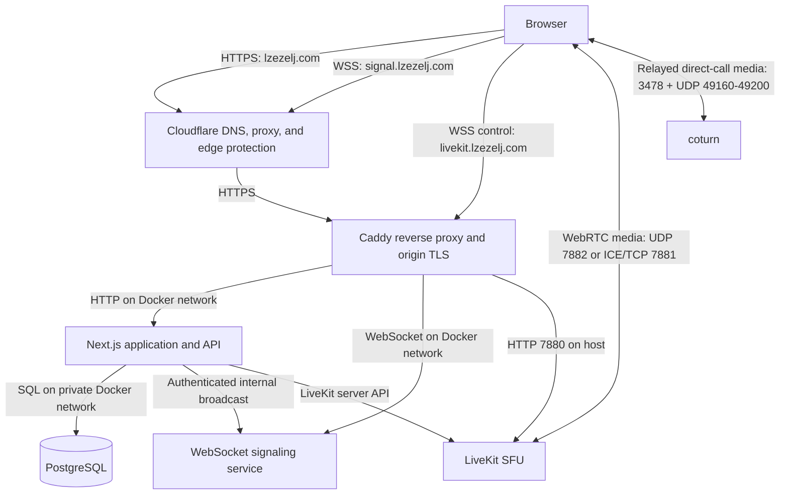
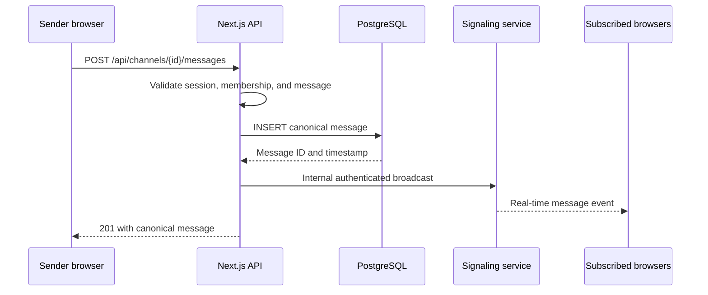
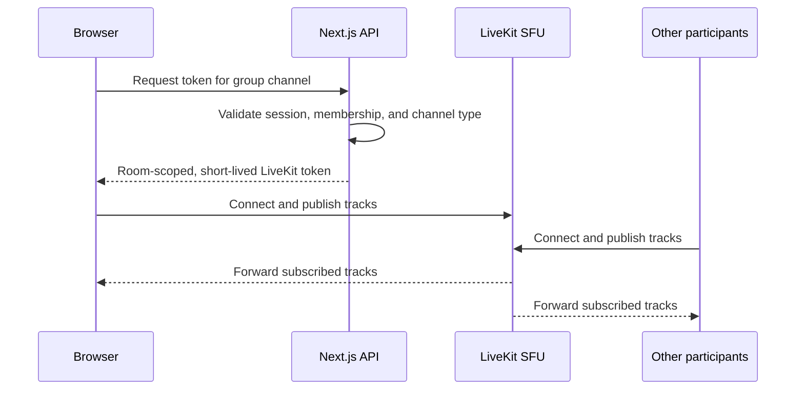

# LC architecture

LC is a self-hosted, invitation-only communication application built as a
portfolio project. It supports persistent text chat, direct two-person WebRTC
calls, and multi-person calls through a LiveKit selective forwarding unit
(SFU).

This document describes the system as it exists today. The final section calls
out limitations and possible scaling paths instead of presenting the current
single-server design as production infrastructure for a large public service.

## Goals

- Let one owner and a server-managed allowlist of Google accounts sign in.
- Let the owner create temporary demo accounts and invite them to a server.
- Persist servers, channels, memberships, and text messages, with non-owner
  accounts limited to three servers they create.
- Deliver new messages and voice presence in real time.
- Support direct two-person voice/video with native WebRTC.
- Support group voice/video without requiring every participant to upload one
  stream per recipient.
- Keep the database, application ports, and internal service credentials off
  the public network.

## High-level topology



The application and signaling hostnames are proxied by Cloudflare. The LiveKit
hostname is DNS-only because WebRTC needs direct connectivity to the media
server. Caddy still provides HTTPS for LiveKit's WebSocket control connection;
the high-volume media path uses LiveKit's dedicated RTC ports.

## Component responsibilities

### Browser

The browser renders the Next.js client, captures microphone/camera/screen media
after an explicit permission request, opens the authenticated signaling
WebSocket, and creates WebRTC connections.

For direct calls, browsers negotiate with each other and send media peer to
peer. For group calls, each browser publishes media to LiveKit and subscribes
to tracks selected by LiveKit.

Voice membership is independent from navigation. The client keeps the active
direct peer connection or LiveKit room mounted while the user visits another
server or text channel, and disconnects only when the user leaves or joins a
different voice channel. Microphone capture requests mono 48 kHz audio with
browser echo cancellation, noise suppression, and automatic gain control.
Server navigation fetches the destination channels and members before swapping
the visible workspace, leaving the current screen usable instead of covering it
with an intermediate loading overlay.

### Cloudflare

Cloudflare is the authoritative DNS provider. It proxies the application and
signaling hostnames, terminates the public edge connection, filters common
automated traffic, and forwards allowed requests to Caddy over TLS. Cloudflare
does not proxy the LiveKit media ports.

### Caddy

Caddy is the only public HTTP reverse proxy on the Hetzner server. It obtains
and renews origin certificates and routes requests by hostname:

| Hostname | Destination |
| --- | --- |
| `lzezelj.com` | Next.js on `app:3000` |
| `signal.lzezelj.com` | signaling service on `signaling:3001` |
| `livekit.lzezelj.com` | LiveKit HTTP/WebSocket endpoint on host port `7880` |

### Next.js application

Next.js provides the React interface and server-side API routes. Its server
responsibilities include:

- Auth.js authentication and session validation.
- Owner, server-owner, and server-membership authorization.
- Owner-authorized renaming of servers, channels, and managed demo users, plus
  authenticated self-service username changes.
- Drizzle queries and transactions.
- Creation of short-lived signaling tokens.
- Creation of room-scoped LiveKit participant tokens.
- Persistence of text messages before real-time delivery.
- Server-side LiveKit presence queries.

### PostgreSQL and Drizzle

PostgreSQL is the source of truth for durable application state. The main data
model contains:

- users and linked OAuth accounts;
- hashed demo invitations and their expiry/revocation state;
- servers and server memberships;
- text, direct-voice, and group-voice channels;
- persistent text messages, reply relationships, and deletion timestamps;
- stable public user handles, friendships, friend-only direct messages, and a
  friendship activity timestamp used to order recent conversations. Sending a
  direct message or starting a direct call updates that timestamp. Direct
  message history also stores typed call-ended entries and their duration.

Drizzle defines the schema and migrations. A one-shot migration container runs
after PostgreSQL becomes healthy and before the application starts.

### Signaling service

The custom Node.js WebSocket service handles low-latency coordination. It does
not persist authoritative text messages and normally does not carry audio or
video. It provides:

- channel subscriptions authorized by a signed token;
- direct-call join/leave coordination;
- WebRTC offer, answer, and ICE-candidate relay;
- voice presence broadcasts;
- real-time delivery of text messages and deletion events that the Next.js API
  has already stored.
- authenticated per-user events for friendship refreshes, direct-message
  notifications, and friend-to-friend incoming-call prompts;
- server-scoped online-presence subscriptions;
- authenticated administrative disconnection when membership changes.

The service keeps connections and rooms in memory. Clients reconnect and
resubscribe after a dropped WebSocket connection.

Online state is derived from authenticated WebSocket connections rather than a
database flag. The signed token includes current server IDs, and the signaling
service accepts a presence subscription only for one of those servers. Closing
the last socket for a user removes that user from the server's online set. The
browser keeps this website-level connection open even when the user has no
server or has not joined a voice channel, so online does not mean “in a call.”

Opening the website-level socket broadcasts presence to every server in its
token, so a user remains online while viewing Friends or a different server.

### LiveKit

LiveKit is the group-call SFU. Each publisher normally uploads one copy of a
media track to LiveKit. LiveKit then forwards appropriate copies to
subscribers. This avoids the upload cost of a full peer-to-peer mesh.

LiveKit runs with host networking so it can advertise and bind predictable RTC
ports. The Next.js server uses the LiveKit server API for room presence and
issues participant tokens scoped to a single `channel-{id}` room.

## Authentication and authorization

### Google login and allowlist

Google authentication succeeds only when Google reports a verified email that
matches `OWNER_EMAIL` or one of the comma-separated addresses in
`ALLOWED_EMAILS`. Both variables are deployment configuration; there is no API
or UI for changing the allowlist. The `OWNER_EMAIL` account retains the global
`owner` role. Other allowlisted accounts receive the `member` role, can create
and administer up to three servers they own, and cannot administer demo
accounts. Auth.js uses a signed JWT session strategy, while linked OAuth
account data is stored in PostgreSQL. Whenever the session is accessed, the
JWT callback revalidates that the user still exists and is neither disabled nor
expired. Invalid sessions return no session and Auth.js clears their session
cookie. The browser refreshes its session state at least once per minute and
whenever the window regains focus.

### Demo login

1. The owner selects a server and creates a demo account.
2. The server generates 32 random bytes and returns the token only in the
   invitation URL.
3. Only a SHA-256 hash of that token is stored in PostgreSQL.
4. The invitation expires after four hours.
5. Redemption atomically requires the invitation to be unexpired, unrevoked,
   and unused, then marks it as redeemed.
6. Revocation disables the demo user and removes its server memberships.

Expired demo accounts are also excluded from server and member queries. Their
membership rows are removed when expiration is observed during session
validation or demo-account management. Expiration and revocation preserve the
account's existing messages unless an authorized user explicitly deletes them.

This design prevents a database reader from directly using stored invitation
values as login credentials.

### API authorization

The server never accepts a client-supplied author identity. API routes derive
the user from the authenticated session and verify the relevant server or
channel membership before reading or modifying data. Server creators receive a
server-owner membership and may administer only those servers; the global owner
retains demo-account administration.

Users may inspect and delete messages authored by their own account. The owner
may do the same only for demo accounts that the owner created. Ordinary message
deletion is a soft deletion: the content is erased while the row remains so
replies can display a stable `Deleted message` placeholder. This is checked by
the API; it is not only a UI restriction. The confirmation UI also offers an
explicit, default-off permanent deletion. Permanent deletion removes the row;
the reply foreign key uses `ON DELETE SET NULL`, so replies survive without a
reference to content that no longer exists.

The owner can replace a demo account's server memberships, regenerate its
short-lived invitation, revoke it, or delete it. Membership replacement must
retain at least one server. Account deletion either permanently deletes the
account's messages and user row, or anonymizes the disabled user as
`Deleted user` so retained messages remain attributable without retaining the
demo identity.

### Signaling authorization

The browser requests a signaling token from Next.js. Next.js reads the user's
current channel memberships and signs this identity and channel list with
HMAC-SHA256 using `AUTH_SECRET`. The token expires after 60 seconds and is
verified with a timing-safe signature comparison by the WebSocket service.

The short lifetime limits token reuse. Administrative membership changes call
the internal disconnect endpoint, forcing affected sockets to reconnect before
receiving a refreshed permission list.
The browser caches a signaling token for at most 45 seconds so its independent
presence, text, and direct-call sockets do not each consume a token issuance.
Access and friendship changes invalidate that cache immediately. Server and
channel navigation updates subscriptions on the persistent presence socket
instead of reconnecting it.

### LiveKit authorization

Next.js checks that the authenticated user belongs to the channel's server and
that the channel is a group voice channel. It then signs a LiveKit token with a
10-minute lifetime and a grant allowing entry only to that channel's room. The
LiveKit API secret is never sent to the browser.

## Text-message flow



Persistence happens before broadcast. A client cannot use the public WebSocket
to invent an authoritative text message. If the internal broadcast fails, the
message remains stored and clients recover it when they reconnect or reload the
latest history. Replies store the referenced message ID. Deletions follow the
same API-to-signaling path as new messages, so connected channel subscribers
replace the content immediately without polling.

Channel history is fetched newest-first in cursor pages of 50 messages. The
browser displays each page chronologically and requests the next 50 older
messages only when the user selects the load-more control. The cursor contains
the oldest message timestamp and ID, which makes pages stable when timestamps
are shared and new messages arrive concurrently.

Direct messages use the same persistence-before-notification rule. After the
API stores a message and updates friendship activity, signaling sends the
recipient a per-user event. An open conversation updates immediately;
otherwise the browser increments its local unread and title counters.
Friendship writes emit the same kind of refresh event so both users see request
and acceptance changes without reloading.

## Direct WebRTC call flow

```mermaid
sequenceDiagram
  participant A as Browser A
  participant S as Signaling service
  participant B as Browser B

  A->>S: Send friend-authorized call invitation
  S-->>B: Show prompt and play ringtone
  B->>S: Accept and join direct-call room
  S-->>A: Peer present; choose initiator
  A->>A: Create RTCPeerConnection and offer
  A->>S: Relay SDP offer
  S->>B: SDP offer
  B->>B: Set offer and create answer
  B->>S: Relay SDP answer
  S->>A: SDP answer
  A->>S: Relay ICE candidates
  S->>B: ICE candidates
  B->>S: Relay ICE candidates
  S->>A: ICE candidates
  A<<-->>B: DTLS-SRTP audio/video media
```

Either participant can send an explicit hang-up signal. Both browsers then
close their peer connection and media tracks immediately. The participant who
ends the call writes one durable call-history entry, which is delivered to the
other participant through the direct-message notification path. Declined calls
are recorded as `Call declined`. If the recipient does not join within 20
seconds, the caller cancels the invitation and records `User unavailable`.

Signaling and media are separate planes. The signaling service introduces the
peers and relays negotiation metadata; after ICE succeeds, direct media does
not pass through it. A Google STUN server helps each browser discover a public
candidate. When `TURN_URLS` and `TURN_SECRET` are configured, an authenticated
Next.js endpoint mints one-hour TURN REST credentials and coturn can relay
direct-call media for restrictive or symmetric NATs. The shared TURN secret
remains server-side. A direct peer connection can still expose network addresses
when ICE selects a peer-to-peer route. The in-call diagnostics identify whether
the selected local candidate is `host`, `srflx`, or `relay` and report audio
jitter, packet loss, concealment, codec, bitrate, and transport protocol.

Direct-call audio prefers mono Opus at up to 64 kbps with in-band forward-error
correction. Discontinuous transmission is disabled, and receive jitter buffering
is left to the browser's adaptive implementation. This avoids the latency and
audio discontinuities caused by the earlier forced 200 ms buffer and 32 kbps
DTX configuration.

Direct-call speaking indicators use a fast local detector with a continuously
learned noise floor. A user's own name updates immediately from their captured
microphone track. The resulting speaking state is sent over the authenticated
signaling connection so every channel observer sees the same prompt indicator.
Decoded-audio health remains available through receiver diagnostics; using the
decoded output to drive highlighting would add the receive jitter-buffer delay.

Direct and group calls share a floating-point audio detector and a reusable
AudioContext unlocked during a call gesture. Its silent output connection keeps
analysis active on mobile browsers without playing microphone audio. Capture
mute/end and context suspension clear the light immediately; group track
restarts and device changes reattach the detector. Microphone menus expose a
restart action and a persistent processing toggle for comparing browser echo
cancellation, noise suppression, and gain control during audio troubleshooting.
Diagnostics include actual capture state and sample rate. Browser/device
crackling has not been verified resolved; low lifetime packet loss alone does
not rule out brief network loss or capture/output distortion.

Direct server voice rooms remain joined when the other participant leaves. The
remaining browser keeps its signaling room and local media, discards the stale
peer connection, and negotiates a new peer connection when another participant
joins. Direct friend calls retain phone-call semantics and end for both users.
Group-call diagnostics are collected separately from LiveKit's publisher and
subscriber peer connections rather than from the direct-call connection.

Incoming direct-call audio plays through a dedicated audio element. Video can
be hidden when the camera is off without suppressing audio playback. The
signaling socket's close handler ignores obsolete sockets so an old disconnect
cannot reset a newer connection. A server owner may disconnect a participant
from a specific voice channel through an authenticated API; direct rooms close
that participant's signaling socket, while group rooms remove the corresponding
LiveKit participant. Server membership is unaffected.
When a direct-room user reconnects, signaling replaces that user's previous
socket before checking the two-person capacity; a late close from the old
socket does not emit a false peer departure.

## Group-call flow



Transport between participants and LiveKit is encrypted, but the current
LiveKit deployment does not enable application-level end-to-end encryption.
The SFU must process media packets to route them. LiveKit offers UDP media and
ICE/TCP fallback, but TURN has not yet been configured.

## Membership revocation and moderation

Kicking a server member, changing demo-server assignments, revoking an account,
or deleting an account follows one control path:

1. Next.js verifies that the actor owns the relevant server or demo account.
2. PostgreSQL membership or account state is changed.
3. Next.js calls the signaling service's authenticated internal disconnect
   endpoint for that user.
4. The signaling service sends `access-changed` and closes matching sockets
   with code `4003`. The browser refreshes its session, server/navigation, and
   friendship state in place, and a new connection requires a token containing
   current permissions. This avoids a full-page reload loop while still letting
   an already-open no-server page discover when access is added.
5. Next.js enumerates LiveKit participants in affected group rooms and removes
   every participant identity prefixed by the user's ID.

This makes removal immediate for text signaling, direct WebRTC, presence, and
group media rather than waiting for the browser to refresh.

## Public and private network boundaries

| Port | Exposure | Purpose |
| --- | --- | --- |
| `22/tcp` | Public only from the administrator's IP | SSH administration |
| `80/tcp` | Public | HTTP validation and HTTPS redirect |
| `443/tcp` | Public | Application, signaling, and LiveKit control TLS |
| `7881/tcp` | Public | LiveKit ICE/TCP fallback |
| `7882/udp` | Public | LiveKit RTC media |
| `3000/tcp` | Docker-private | Next.js |
| `3001/tcp` | Docker-private | signaling service |
| `5432/tcp` | Docker-private | PostgreSQL |
| `7880/tcp` | Host-local, blocked by cloud firewall | LiveKit HTTP/WebSocket origin |
| `3478/tcp + udp` | Public | TURN allocation and fallback transport |
| `49160-49200/udp` | Public | coturn relay media range |

PostgreSQL has no production host-port mapping. Next.js and signaling are
reachable externally only through Caddy. The Hetzner firewall is the public
enforcement layer for LiveKit and SSH ports.

## Deployment lifecycle

Production currently uses a manual Git-based deployment:

1. Changes are tested locally, committed, and pushed to the public GitHub
   repository.
2. The `lc` user pulls the commit on the Hetzner server.
3. Docker Compose builds the multi-stage Node.js image.
4. PostgreSQL starts and passes its health check.
5. The migration container applies pending Drizzle migrations and exits `0`.
6. Next.js and signaling start and pass their health checks.
7. Caddy starts after the application services are healthy.
8. LiveKit starts with host networking and fixed RTC ports.

The final application container runs as an unprivileged `nextjs` user. Runtime
dependencies are installed without development dependencies. Containers use
`restart: unless-stopped`, so the stack returns after a host reboot.

## Configuration and secrets

Development settings live in the ignored local `.env`. Production settings
live only in the server's ignored `.env.production`, with restrictive file
permissions. Docker Compose passes only the values required by each service.

Secrets are not built into the Git repository or Docker build context. Public
client configuration such as `NEXT_PUBLIC_SIGNALING_URL` is intentionally
embedded during the frontend build; credentials such as OAuth, database,
signaling, and LiveKit secrets remain server-side.

`ALLOWED_EMAILS` is also server-only configuration. It is a comma-separated
Google-email allowlist in the local development `.env` and production
`.env.production`; production Compose passes it only to the Next.js service.

## Rate limiting

The single Next.js instance keeps short-lived rate-limit counters in memory.
Login starts are limited to 10 attempts per IP address per 15 minutes. Message
creation is limited to 10 messages per authenticated user per 10 seconds.
Server and channel changes are limited to 10 per user per hour, and demo-account
administration is limited to 30 owner actions per hour. Signaling token
issuance is limited to 120 requests per user per minute to accommodate the
application's independently authenticated persistent, text, and direct-call
sockets; LiveKit token issuance remains limited to 30 requests per user per
minute. Rejections use
HTTP 429 and a `Retry-After` header. This prevents ordinary burst spam but is
not shared across processes; a multi-instance deployment must move counters to
Redis or an equivalent shared rate-limit store.

## Failure behavior

- **Signaling interruption:** WebSocket clients reconnect and resubscribe. Text
  history remains available from PostgreSQL.
- **Real-time text broadcast failure:** the database write remains canonical;
  clients recover through history reload.
- **Migration failure:** Compose does not start the application, preventing new
  code from running against an incompatible schema.
- **Application failure:** health checks expose the failure. Docker's restart
  policy restarts a process that exits, but a merely unhealthy container needs
  operator action because Docker Compose does not restart it automatically.
- **LiveKit failure:** group media and presence fail, but text chat and direct
  WebRTC use separate services.
- **Host failure:** every production component is currently on the same host,
  so Hetzner backups are the infrastructure recovery mechanism.

## Observability

Current visibility comes from:

- Hetzner CPU, disk, and network graphs;
- Cloudflare request, bot, error, and bandwidth analytics;
- Docker container health and restart state;
- application, signaling, LiveKit, PostgreSQL, and Caddy logs;
- `/api/health` and signaling `/health` endpoints.

There is no centralized log store, distributed tracing, alerting service, or
application-level owner dashboard yet.

## Current limitations and trade-offs

- The CAX11 and all services on it are a single point of failure.
- Deployment is manual; there is no CI/CD approval or rollback pipeline.
- PostgreSQL is a single instance with no replica or independent logical backup
  workflow.
- The signaling service stores rooms in process memory and cannot be scaled
  horizontally without shared state or a message broker such as Redis.
- LiveKit is a single node and has no Redis-backed multi-node routing.
- Direct WebRTC calls depend on the single-host coturn service whenever a
  peer-to-peer ICE route cannot be established; that relay has no regional
  redundancy.
- LiveKit has UDP and ICE/TCP but no TURN/TLS relay for highly restrictive
  networks.
- Signaling permissions are captured when the short-lived connection token is
  issued. Administrative changes actively close sockets, but purely time-based
  expiry is enforced when the session/token is next refreshed.
- Monitoring is mostly manual.
- Rate-limit counters are local to one Next.js process and reset on restart;
  they are not suitable for horizontally scaled application instances.
- Demo-account expiry removes server access but intentionally retains the user
  and message records until an authorized user explicitly deletes messages or
  a later account-deletion workflow anonymizes them.

These choices are appropriate for a small portfolio deployment: they keep cost
and operational complexity low while preserving clear service boundaries.

## Scaling path

If LC needed to support a larger public workload, a reasonable sequence would
be:

1. Add external monitoring, structured logs, alerts, and tested PostgreSQL
   logical backups.
2. Add TURN over TLS on port 5349 and measure call success, bandwidth, and relay
   cost; the initial coturn deployment supports TURN over UDP/TCP on port 3478.
3. Move PostgreSQL to a separately backed-up host or managed service.
4. Add Redis for shared signaling presence and LiveKit multi-node coordination.
5. Run multiple stateless Next.js and signaling instances behind a load
   balancer.
6. Run multiple LiveKit nodes selected by region and room placement.
7. Move builds to CI and deploy immutable, versioned images with rollback.

The main scaling distinction is between the control plane and media plane.
Next.js, PostgreSQL, authentication, and signaling coordinate identity and
state. LiveKit carries bandwidth-intensive group media. They should be measured
and scaled independently.
