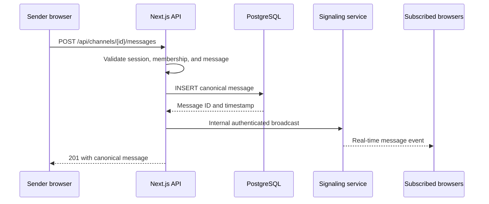

# Messaging and conversation history

## Consecutive message presentation

ImagePreview supports pointer-anchored wheel zoom from fit size to 500%, bounded
drag panning, explicit zoom buttons and Reset. Wheel events are captured only
inside a ready image preview; resizing clamps pan bounds. The same viewer serves
sent pictures and local composer previews, retaining existing download and access
behavior. `image-zoom.ts` owns the tested zoom/pan calculations.

`ChatHistory` uses `message-sequences.ts` to visually join consecutive messages
from the same author in server and direct histories. Author changes, call events,
deleted messages, replies and the unread divider interrupt incoming groups.
Continuation rows omit the repeated visible author/avatar but retain a keyboard
accessible profile control, timestamp, edit indicators and independent message IDs,
actions, reactions and attachments. Pagination recalculates groups over loaded
history. No message data is merged or changed; grouping has no time cutoff.
Boundary behavior is covered by `tests/message-sequences.test.mjs`.

Group headers show timestamps beside the name; continuation rows reveal timestamps
on hover or keyboard focus. Touch-only devices keep continuation times visible.
Timestamps remain accessible and edit indicators stay visible. Received headers
read avatar/name/time; sent headers mirror this to time/name/avatar. Dates use the
viewer’s local calendar and locale: time today, Yesterday at time, otherwise date
at time. One shared minute/focus clock updates day labels across midnight without
per-message timers. Missing legacy timestamps retain their existing time label.
Reply references use a compact quoted block with neutral author text; composing
a reply shows an excerpt beside the existing cancel control. Backend reply and
deletion contracts are unchanged.
Choosing Reply focuses the composer with the caret after any existing draft,
including when choosing the same reply again. Disabled/busy composers defer focus
until editable. Quoted replies retain a left border; selected channels and mentioned
messages use fills rather than left-edge stripes.
Clicking a reply reference centers and highlights the original loaded message.
For older references, the client uses the existing authorized message-search
context endpoint and offers Jump to present. Repeated clicks refocus the same
target. New jumps, search selections and conversation changes cancel obsolete
requests; deleted/inaccessible originals leave the current history intact and
show an error. No reply API or access rules change.

Composers, drafts, emoji/reactions, edits, search, attachments, persistence, delivery, pagination, caches and deletion.

[Architecture overview](../../ARCHITECTURE.md) · Related: [Authentication and authorization](authentication.md), [Notifications and activity](notifications.md), [Workspace UI and navigation](ui.md), [Database and persistence](database.md).

## Direct conversations and friendship

The Messages workspace separates conversations from friendship. Active non-demo
accounts can message accepted friends, users sharing a server, or peers with
existing direct-message rows. `server/direct-conversations.ts` owns this predicate;
each history/send/edit/search/reaction/attachment/read/preference API checks it
independently and still scopes message IDs to the signed-in pair. Unrelated peers,
self, disabled/expired accounts and demo accounts are denied. Calls and call-history
events retain their separate accepted-friend checks; message permission never
grants call permission.

GET `/api/conversations` merges friendships, shared-server contacts and peers derived from stored messages,
returning profile metadata, friendship status (including `none`), messaging access,
latest activity and a bounded 160-character latest-text preview. POST resolves a
permitted peer for a new Message action without creating a durable empty thread.
The first message makes the conversation durable. No schema migration or separate
conversation table is needed. Unfriending deletes only the friendship: existing
history remains available, including after both users leave their shared servers.
If every message is permanently erased and no friendship/shared server remains,
there is no remaining conversation to list or authorize. Soft-deleted rows retain
the relationship and display the existing Deleted message placeholder.

Lists derive peers from the account's message rows and use existing pair/timeline
indexes for previews. This adds reads proportional to that account's history and
is intended for the current small deployment, not an unbounded public messenger.
GET `/api/friends` remains the social-graph endpoint for accepted/pending friendships.

## Reconnect and history recovery

Owner-only app-wide inspection and moderation use separate APIs; ordinary message
authorization stays membership/conversation scoped. See [Application administration](admin.md)
for admin-edit attribution, transactional audit history and moderation notifications.

Signaling sends protocol ping frames every 30 seconds; browsers answer pong frames
without JavaScript timers. A connection missing the next heartbeat is terminated
through normal disconnect cleanup. This prevents idle connections from remaining
silent through proxies and detects broken peers. Reconnects still invalidate
history caches to recover missed changes, but an account/conversation-scoped
snapshot keeps the currently loaded messages and loading-ready state visible.
Recovery fetches 50-message pages through the previous oldest cursor (or the end
if all history was loaded), then reconciles persisted edits/deletions with live
updates received during recovery. Denied or missing conversations clear retained
content; temporary failures leave it visible and retry on a later reconnect.
Navigation aborts recovery and rejects obsolete responses. No production proxy
timeout or infrastructure configuration was changed.

## Conversation drafts

My messages settings reuses a bounded, account-scoped snapshot between visits and
revalidates on each mount; see [settings cache lifetime](ui.md#cached-navigation-and-loading).
The history endpoint still returns the account's full sent history; client caching
does not remove that endpoint's growth limitation.

Pasting clipboard images into either chat composer adds them to the existing
attachment draft with local previews; Send or Enter submits them. Ordinary text
paste is unchanged. Clipboard images use the same file/count/size/type limits,
edit/busy guards, authenticated upload API and draft lifetime as picked files.
Draft image thumbnails open the same focus-trapped image-preview dialog used by
sent images. Draft previews reuse their local Blob URLs without uploading or
submitting; closing restores focus and removing the file closes its preview and
releases its URL.
Soundboard tiles and sound settings truncate long names with an ellipsis and
retain the full name in a hover title. Browser/OS screen-capture indicators are
controlled by the browser and cannot be suppressed by LC.

`useConversationDraft` keeps unsent text and selected `File` objects in the mounted
workspace's React state, keyed by channel UUID or DM peer UUID and scoped to the
signed-in account. Switching servers, channels or direct conversations restores
the matching draft immediately. Reloading/unmounting or changing accounts clears
all drafts; there is no browser-storage, cross-tab or server synchronization.
Empty drafts are removed. Attachment previews release their object URLs on
unmount and recreate them from the retained files when the conversation returns.
Successful sends clear only the original draft object, even after navigation;
newer text/files and drafts in other conversations are preserved. Failed sends
leave the draft available. Message editing remains separate from unsent drafts.

## Emoji and message reactions

The composer and reaction controls share a searchable local Unicode emoji catalog
and an accessible picker rendered above chat clipping boundaries. Composer picks
insert at the saved caret/selection and remain ordinary persisted message text.
The centered SVG trigger sits immediately before Send. Reactions are added through
the message context menu's React action; messages without reactions have no extra
button or row. Chips open a shared, focus-trapped dialog listing every reactor;
only the viewer's own row offers a removal button. Details are fetched on demand
through the same conversation authorization and refreshed on live invalidations.
Participant lists reuse the bounded `SessionCache` in memory (100 lists / 512 KiB,
five-minute reuse window), scoped to the signed-in account and conversation/message.
Reopening paints cached rows immediately and revalidates in the background;
uncached lists use the shared delayed, reduced-motion-aware skeleton. Forbidden,
unauthorized or missing-message responses remove cached details. Nothing is written
to browser storage. Closed or superseded requests cannot update the cache/UI.
When reaction rows grow below the viewport, only the chat pane scrolls enough to
reveal the currently visible message; offscreen history does not pull the reader.
The shared menu picker
keeps pointer/scroll interactions inside its portal from closing the parent menu.
React opens on pointer hover with a centered submenu arrow, prefers the right
side and flips/clamps at viewport edges. A short pointer-leave delay bridges the
gap into the portal; clicking remains available for touch, with Arrow Right and
Escape/Arrow Left for keyboard access. Hover opening does not steal keyboard focus.
Migration `0020_message_reactions` adds separate channel/direct reaction tables,
with cascading user/message deletion and triggers
that remove reactions on soft deletion. Calls and deleted messages cannot receive
reactions. `/api/message-reactions` authorizes server membership or permitted DM
conversation access, constrains message IDs to that conversation, rate-limits mutations,
and derives the reacting user exclusively from the session. Adds/removals are
idempotent; responses aggregate counts and the viewer's own participation.
Migration `0021_single_message_reaction` enforces one reaction per message/user.
Selecting another emoji atomically replaces the existing row. Existing multiple
reactions are reduced deterministically to one emoji (bytewise order), since the
old rows have no creation timestamps from which to identify the latest choice.
GET batches at most 100 loaded message IDs. The account/conversation-scoped client
state retains only loaded IDs and rejects obsolete/out-of-order responses.
Channel invalidations travel through the authenticated internal signaling endpoint
only to authorized subscribers; DM invalidations target the two participants.
Events re-fetch only affected reaction metadata, without clearing message history,
refreshing unread counts or affecting calls. Focus, online and signaling recovery
refresh missed counts. The current catalog supports a curated set of Unicode
emoji; custom emoji uploads are not introduced.

## Text-message flow

Authors can edit their own live channel/DM messages from the context menu.
`PATCH /api/messages/{id}` and `PATCH /api/direct-messages/{userId}/{id}`
recheck author identity and current membership/conversation access, reject deleted messages
and call events, enforce the shared message rate limit and the 4,000-character
bound, and update PostgreSQL before notifying clients. Attachments and reply
relationships remain unchanged; an attachment caption can become empty.
Migration `0014_direct_message_edits` adds the DM edit timestamp; channel messages
already have one. No edit history is retained. The composer displays the selected
text, an Editing message banner, an Edit submit button and an Escape/cancel action.
The prior unsent draft, attachments and reply remain available after editing.
Editor state is scoped to the account and conversation. Deleted messages close
the matching editor and clear content/media in open search context as well.

The authenticated internal `message-edited` endpoint broadcasts committed channel
edits to subscribed text sockets and a body-free `channel-history-changed` cache
invalidation to authorized workspace sockets. Direct edits use per-user
`direct-message-edited` events for both participants, including other tabs. Clients
patch existing rows and cached pages, update visible reply snippets, and show an
edited label without adding unread counts or reordering the conversation. Deleted
rows are never resurrected by delayed edits. Reconnect reloads recover missed edits.

The shared conversation search occupies the chat header for all accounts, replacing
the owner demo menu. Typing triggers search after the shared 500 ms debounce;
Search/Enter runs immediately. Dismissal cancels pending searches and changing
conversation resets the search state; see [shared search behavior](ui.md#shared-controls-and-search-behavior).
GET `/api/message-search` accepts exactly one channel/friend
scope, rechecks current access, and returns up to 50 matches with timestamp/ID
cursors. Search is a parameterized, case-insensitive literal substring match on
text and attachment filenames; deleted rows and DM call entries are excluded.
Queries require 2–100 characters and are limited to 60 requests per account/minute.
This scans stored history in the selected conversation rather than only cached
pages; no full-text/trigram index is added for the small private deployment.
Selecting a result requests a separately authorized `contextId` window (up to 25
messages before and after the target). The UI centers/highlights the target; the
existing down arrow restores the live history instead of a separate return button.
The arrow stays available even at the bottom of the bounded context (or after
all context rows are removed). This context is separate from normal loaded pages
and caches; new arrivals still update the live history while viewing old context.
Search context bounds and cursor values preserve PostgreSQL's full microsecond
timestamps as UTC strings; converting them to JavaScript Date would truncate
precision, include the selected row again among newer neighbors and skip tied
search results on later pages. Display timestamps remain ordinary browser dates.
Search requests are canceled on replacement, dismissal and unmount, and late
responses are ignored. Context is a snapshot and does not provide continuous
forward/backward paging; the down arrow resumes the normal history view.

## Composer, attachments and persisted delivery

Channel chats and DMs share `MessageComposer`. Its textarea retains the
single-line height, grows and shrinks with explicit or wrapped lines up to three
rows, then scrolls vertically. Enter sends; Shift+Enter inserts a newline; IME
composition does not send. A left attachment button and drop target stage up to
20 PNG/JPEG/GIF/WebP images, PDFs or MP4/WebM videos. Images/PDFs are limited
to 10 MiB each, videos to 25 MiB each, with 40 MiB total per message. Uploads show progress,
prevent duplicate sends, and retain staged files/draft on failure or rate limiting.
Staged files are scoped to the account and destination, so navigation cannot
attach them to another conversation.

Message POST endpoints accept JSON for text/call events and multipart for files.
Session and membership/conversation checks precede body parsing. The server bounds
the streamed body before parsing, checks signatures rather than trusting MIME
claims, and sanitizes filenames. `server/message-attachments.ts` locks the
uploader's user row and checks a shared 100 MiB account quota across channels
and DMs, then atomically inserts the message, JSON metadata and private bytea
payloads in PostgreSQL. Concurrent uploads serialize quota checks. No separate
upload step leaves orphaned files. Only metadata travels through message history,
bounded memory caches and signaling. `MessageAttachments` measures available row
width and renders at most two uncropped image/video thumbnails, reserving one tile for the
remaining-image count when necessary. That tile opens a square, three-column
gallery viewport showing three rows with vertical scrolling for further media.
Images and videos share the same thumbnail controls and omit file-details rows.
Videos show a play badge and open a player modal. The overflow placeholder suppresses
context menus and cannot be downloaded. Right-click on an actual image opens an explicit Download
picture/video menu using the authenticated download endpoint. Its portal mounts inside
the active dialog when needed so native modal inertness does not block it;
Escape closes just the menu. PDFs retain their details/download row.
Clicking an image
opens an in-app `SettingsModal` preview, preserving the mounted workspace/call,
with Escape/backdrop/close-button dismissal, focus restoration, loading/error
feedback and the download context menu. Preview/gallery content disappears
when its message is deleted. PDFs download rather than embedding document content.
Selected image files also show local thumbnails in the shared composer before
uploading. Their temporary object URLs are revoked when files change or the
composer unmounts; previews do not upload bytes or modify the send flow.

Migration `0013_message_attachments` adds message metadata and a separate
`message_attachments` table. Message foreign keys cascade permanent removal;
database triggers release bytes and clear metadata on soft deletion, including
bulk/account paths. GET `/api/attachments/{id}` rechecks current server membership
or exact DM participation and permitted conversation access before loading bytes. Deleted
messages are inaccessible. Responses use private/no-store, nosniff, a sandbox CSP
and encoded filenames; there is no public file directory or image optimizer URL.
This storage choice increases PostgreSQL backup size and upload memory use (up
to roughly 40 MiB plus parser/copy overhead per concurrent request). Signatures
identify formats; uploads are not malware-scanned or fully decoded/sanitized.
Object storage and streaming uploads remain future scaling work. No storage
service or production infrastructure change is required, but the migration must
run before this application version starts.

Migration `0026_video_attachments` increases the database byte-size ceiling to
25 MiB; API validation retains the lower image/PDF limit based on detected bytes,
not client MIME labels. MP4 recognition checks a bounded ftyp box and known MP4
major brands; WebM recognition parses a bounded EBML header and DocType. These
checks identify containers rather than fully decoding media or guaranteeing codec
compatibility. Unsupported codecs show playback errors and remain downloadable;
no transcoding worker is introduced. The existing 100 MiB shared account quota,
transactional upload/deletion behavior and authorization apply to videos too.
Migration `0027_attachment_retention` adds a global 2 GiB cap on stored attachment
bytes across channel messages and DMs, in addition to the 100 MiB account quota.
Attachment timestamps are backfilled from their messages. Upload transactions
take a database-wide advisory lock before checking usage; an insert trigger also
enforces the cap. Under upload pressure, the database removes the oldest files
older than 30 days, targeting 1.5 GiB before the incoming upload. If eligible files
cannot free enough space, the transaction rolls back and the upload returns 413.
There is no time-only expiry or migration-time purge. Cleanup preserves message
text and attachment metadata, marking the files expired; downloads return 404
and clients show an expired placeholder. After commit, affected users receive a
refresh notification. Uploaders receive a warning at 80% global usage. The cap
counts attachment payloads, not the entire database, WAL, indexes, or backups;
deleting rows makes database space reusable rather than immediately shrinking
the PostgreSQL files on disk.

Video drafts use local Blob previews without uploading. Sent videos use muted,
paused thumbnails with metadata-only preload, sized like pictures. Clicking opens
an in-app player with native controls, loading/error feedback and a right-click
download menu matching image previews. Closing,
removing or deleting a preview stops playback and releases its source. Video GETs
support single HTTP byte ranges with 206/416 responses after authorization, and
PostgreSQL substring queries return only requested bytes to the application.
Responses retain private/no-store and nosniff headers. Videos are not routed
through WebRTC/LiveKit or recorded from live calls.

Channel/DM delete confirmations show message text and attachment filenames so
attachment-only messages have a meaningful preview. Account message management
also returns attachment metadata and uses the same deletion preview formatter.

Attachment regressions cover parser limits/signatures, quota transaction order
and failure, private-download permissions, and isolated migration cleanup. The
muted workspace browser test exercises the actual composer for explicit/wrapped
line growth and shrinkage, three-row scrolling, Enter/Shift+Enter, file picker,
drag/drop and removal. Mocked API checks do not prove a live two-account transfer.

Persistence happens before broadcast. A client cannot use the public WebSocket
to invent an authoritative text message. If the internal broadcast fails, the
message remains stored and clients recover it when they reconnect or reload the
latest history. Replies store the referenced message ID. Deletions follow the
same API-to-signaling path as new messages, so connected channel subscribers
replace the content immediately without polling.

Channel and direct-message history are fetched newest-first in cursor pages of
50 messages. Both queries order by timestamp and ID for stable ties; direct
history remains restricted to the authenticated pair with permitted conversation access.
GET `/api/friends` returns friendship/profile metadata, the stored activity
timestamp and a bounded last-message preview for each accepted friend. A lateral
query fetches at most one text-message row per direction using the existing
pair/timeline index, then selects the latest by timestamp and ID. Responses contain
at most 160 text characters and the sender ID; attachment-only and soft-deleted
messages return labels, and pending requests have no preview. It does not load
conversation pages, attachments or file bytes. The sidebar shows the preview
below the name, prefixes outgoing messages with You, and refreshes on sends,
edits and deletions. The activity timestamp still controls ordering/time labels.
Direct history loads only while the selected friend's
chat is visible in the Friends workspace, including alongside that friend's DM
call. Retaining a friend selection while viewing a server or another call's media
does not prefetch that conversation. Closing/switching the view aborts the initial
history request and invalidates its generation so late responses cannot restore
hidden or obsolete history. Older-page requests are also gated on chat visibility.
Real-time incoming notifications and unread counts continue independently;
these new-message events do not load past history. No schema migration is needed.
Loaded channel and DM histories, including explicitly fetched older pages and
their next-page cursor, stay in an account-scoped in-memory `ConversationCache`
owned by the mounted workspace. Returning to a fresh cached conversation does
not request history again. Nothing is written to localStorage, sessionStorage,
IndexedDB or a service worker for message content; a full page reload starts
empty. The cache evicts least-recently-used conversations above 40 entries or
5 MiB of serialized UTF-8 content. This bounds cached payloads, not total browser
heap usage or the currently displayed history. Oversized histories remain usable
in the current view but are not cached.
Live DM events update only already-loaded cached conversations. Channel activity
without a cached message body, deletions and access/server changes invalidate
affected snapshots; reopening then reads authoritative PostgreSQL history.
Signaling reconnects clear cached histories and refresh the active view to recover
missed events. Failed fetches are not cached as empty conversations. Server/member
metadata still refreshes independently for current names, roles and access.
Sound audio already uses its separate page-session 24-clip/4-MiB memory LRU;
navigation does not reset it, while reload does. Neither cache stores decoded
audio for inactive playback, starts capture or changes call membership.
The browser displays pages chronologically, opens at the latest message, and
requests 50 older messages when scrolling near the top (with a manual fallback).
A shared history view preserves the visible message when older rows prepend;
new arrivals follow the bottom only when already nearby or sent by the viewer.
A shared down-arrow control appears above Send while the latest message is
outside the history viewport. It returns to the present, hides once the latest
row becomes visible and respects reduced-motion preferences. Resize observation
keeps it aligned with Send in channel and direct-message composers.
Late history responses from obsolete conversations are discarded and overlapping
real-time/history rows are deduplicated. Messages use full-width rows in both
channels and DMs. The viewer's own name, timestamp and message text align right;
other authors' messages align left. Shared message headers open profiles.
Subtle row backgrounds alternate when the author changes, keeping consecutive
messages by the same author visually grouped in both chat views.
The cursor contains
the oldest message timestamp and ID, which makes pages stable when timestamps
are shared and new messages arrive concurrently.

Direct messages use the same persistence-before-notification rule. After the
API stores a message and updates friendship activity, signaling sends the
recipient a per-user event. An open conversation updates immediately;
otherwise the browser increments its local unread and title counters.
Friendship writes emit the same kind of refresh event so both users see request
and acceptance changes without reloading.

Direct-message deletion is sender-only and scoped to the recipient in the API.
Migration `0010_direct_message_deletion` adds a nullable deletion timestamp.
The default action erases content and keeps a `Deleted message` placeholder;
an explicit permanent option removes the row. After the database write, a
`direct-message-deleted` event goes to both users, including their other open
tabs. Clients update the open history and refresh conversation metadata without
counting deletion events as new unread messages. Missed events recover through
the existing history reload. Deletions are rate limited per authenticated user.

## Owner demo-account message management

The owner's demo-account message manager retains per-server groups,
with the currently viewed server first and expanded. Other groups expand on demand.
Each group offers confirmed deletion of that account's messages in its server.
The account-message DELETE API accepts an optional server ID and restricts the
update by both author and channels belonging to that server; invalid filters
are rejected instead of falling back to deletion across all servers. Omitting
the filter retains the existing all-server action. Both actions clear content,
mark messages deleted and broadcast the affected message IDs in real time.

## Source files and validation

- [app/message-composer.tsx](../../app/message-composer.tsx)
- [app/api/channels/[channelId]/messages/route.ts](../../app/api/channels/[channelId]/messages/route.ts)
- [app/api/direct-messages/[userId]/route.ts](../../app/api/direct-messages/[userId]/route.ts)
- [app/conversation-cache.ts](../../app/conversation-cache.ts)

Relevant tests: [message-pagination.test.mjs](../../tests/message-pagination.test.mjs), [message-editing.test.mjs](../../tests/message-editing.test.mjs), [message-attachments.test.mjs](../../tests/message-attachments.test.mjs), [friend-requests.test.mjs](../../tests/friend-requests.test.mjs).

Run the tests for the affected message path and `npm.cmd run build`. Use the relevant browser mode from the test guide when changing composer, history scrolling or attachment playback.
See the [test guide](../../tests/README.md) for browser prerequisites and mode details.
