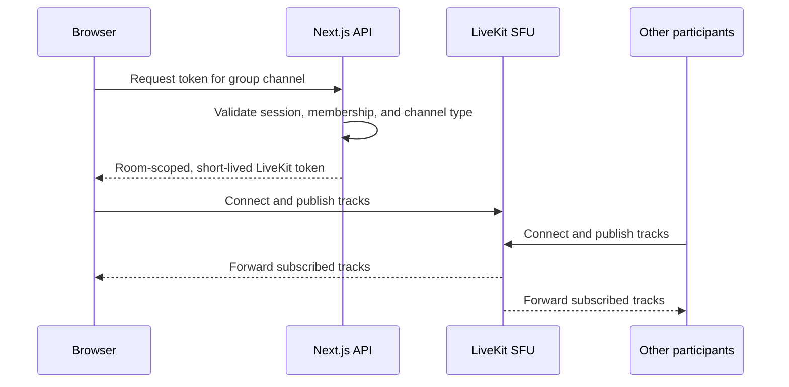

# Voice sessions and transports

Signaling, native WebRTC, LiveKit, persistent call ownership, device handoff, reconnects and owner moderation.

[Architecture overview](../../ARCHITECTURE.md) · Related: [Authentication and authorization](authentication.md), [Media capture and audio processing](media-and-audio.md), [Server soundboards and join sounds](soundboards.md), [Servers, channels and presence](servers-and-presence.md), [Infrastructure, deployment and operations](infrastructure.md).

## Browser

The browser renders the Next.js client, captures microphone/camera/screen media
after an explicit permission request, opens the authenticated signaling
WebSocket, and creates WebRTC connections.

For direct calls, browsers negotiate with each other and send media peer to
peer. For group calls, each browser publishes media to LiveKit and subscribes
to tracks selected by LiveKit.

## Persistent media across navigation

Voice membership is independent from navigation. The client keeps the active
direct peer connection or LiveKit room mounted while the user visits another
server or text channel, and disconnects only when the user leaves or joins a
different voice channel. Microphone capture requests mono 48 kHz audio with
browser echo cancellation, noise suppression, and automatic gain control.
Direct-call audio is mounted in `CallMediaProvider` above the Friends/server
workspace branches. Switching those branches cannot replace the audio element;
video previews restore their stored streams after navigation. Remote previews
are muted because the persistent audio element alone plays received sound.

## Server voice moderation

Migration `0023_voice_moderation` adds persistent, independent `voice_muted` and
`voice_deafened` flags to each server membership. The authenticated
`/api/servers/[serverId]/voice-moderation` endpoint allows members to read the
roster and only the current server owner to change another member's flags. The
transaction locks memberships, commits before updating media, then sends targeted
`voice-moderation-changed` events without invalidating visible message history.
Policies follow the member across this server's voice channels; new memberships
default off. Ownership transfer clears restrictions on the new owner. Own mic
preferences are retained underneath the enforced policy. Joins and signaling
reconnections reload policy state, including after missed events.
Channel indicators merge this saved policy over reported self state: server
mute/deafen use red icons and cannot disappear following self-undeafen presence
updates. Matching normal/personal icons are suppressed. Owner actions switch to
Server unmute/undeafen when active; server-deafened users cannot trigger the
self-undeafen action. Personal controls are centered in one row, and crowded voice
names truncate with a full-name title while the icons retain their width.

Next.js updates matching account identities in this server's LiveKit rooms and
limits fresh tokens to camera/screen video sources when server-muted/deafened,
blocking microphone, soundboard and screen audio. Server deafen additionally
sets `canSubscribe: false`: SFU enforcement blocks incoming video as well as audio.
Native peer-to-peer moderation depends on the official clients applying the
policy; a modified peer cannot be forced to stop transmitting by a central SFU.
Personal LiveKit deafen depends on the publisher honoring its subscription
permissions. Existing self-hosted token-replay limitations still apply. Failed SFU
updates return `mediaSynced: false` and show a warning; a stored choice is not
reported as proof that an unavailable SFU applied it. Real multi-account SFU
moderation still requires verification against the deployed media service.

## Signaling service

The custom Node.js WebSocket service handles low-latency coordination. It does
not persist authoritative text messages and normally does not carry audio or
video. It provides:

- channel subscriptions authorized by a signed token;
- direct-call join/leave coordination;
- WebRTC offer, answer, and ICE-candidate relay;
- voice presence broadcasts;
- real-time delivery of text messages and deletion events that the Next.js API
  has already stored.
- authenticated per-user events for friendship refreshes, direct-message
  notifications, and friend-to-friend incoming-call prompts;
- server-scoped online-presence subscriptions;
- authenticated administrative disconnection when membership changes.
- authenticated server-update events after a server or channel rename, so open
  clients reload the authoritative server, channel, and member labels.

The service keeps connections and rooms in memory. Clients reconnect and
resubscribe after a dropped WebSocket connection.

## Friend-call cancellation

Explicit friend-call hangup also sends an authenticated `call-cancel` through
the account's presence socket before recording the outcome clears its partner.
The receiver has not joined the media room while ringing, so room-only `hangup`
cannot dismiss that invitation. The server derives cancellation identity and
room from the signed caller and accepted friend; receivers match both caller and
room before clearing the invitation. Disconnect uses the selected active call
even before its media socket is ready, and delayed animation-frame joins check
the voice session so an immediate hangup cannot start capture afterward.

## LiveKit

LiveKit is the group-call SFU. Each publisher normally uploads one copy of a
media track to LiveKit. LiveKit then forwards appropriate copies to
subscribers. This avoids the upload cost of a full peer-to-peer mesh.

LiveKit runs with host networking so it can advertise and bind predictable RTC
ports. The Next.js server uses the LiveKit server API for room presence and
issues participant tokens scoped to a single `channel-{id}` room.

## One active voice connection per account

A new voice join transfers the account's call from its previous tab/device,
including between servers, native channels, group channels and friend calls.
Ordinary workspace navigation does not claim a new connection or leave a call.
The signaling process serializes admission per authenticated account through
`server/voice-sessions.mjs`. Direct sockets claim after channel/friend authorization;
the group-token API checks membership before calling the authenticated internal
`/internal/claim-voice` endpoint. A browser-generated session UUID identifies
each join and is included in the LiveKit identity after the account prefix.

Before admitting a different session, signaling calls Next.js's secret-authenticated
`POST /api/internal/voice-media`. Next.js uses the LiveKit server API to
find and remove that account's participants across rooms, including orphaned
media after a signaling restart. A media-service failure rejects admission.
It then detaches the old native socket/presence and sends `voice-replaced` with
the old session ID. The matching browser stops capture, clears call UI and
cancels automatic reconnect on that explicitly replaced client; delayed events
cannot close a newer session. The client displays a confirmation dialog with
an OK button in every workspace, retaining it until dismissed.
If LiveKit's disconnect arrives before signaling's replacement event, the browser
retains that disconnected session ID solely to match the notice. The notice can
then appear after media cleanup in every workspace. A new join or explicit leave
clears that ID, and a late event cannot disconnect a newer call.
Group token/capture generation guards discard responses after replacement.
Group presence confirms pending admission; unconfirmed admissions expire after
35 seconds, and a brief socket outage retains ownership for reconnect. Native
automatic reconnects retain their session ID and can reclaim a call from a
temporary device when the original device's internet returns. Group signaling
and SDK reconnects explicitly reannounce recovery; admission removes the temporary
device while preserving the returning session's own SFU identity. Ordinary stale
group presence is still rejected and cannot silently reclaim a call.
After an unexpected terminal group transport failure the mounted client shows an
error explaining that the internet connection or LiveKit may be unavailable,
and retries every five seconds while online or immediately on the browser's
online event. Its microphone mute preference survives these retries. Explicit
leave, handoff, owner removal, room deletion or account/access rejection cancels
recovery. Reloading the site still starts with no call; no persistent recovery
across a whole-site outage is added. Errors appear in all workspace branches.
Cleanup checks session IDs so an old socket cannot release its replacement.

Signaling has no scheduled restart. Production Compose uses `restart: unless-stopped`
to recover after process exit or host restart; deployments/manual restarts can
also replace it. Development uses Node's file watcher to restart signaling after
source edits. The health check observes readiness and does not schedule restarts.

This coordinator remains in the single signaling process; multiple signaling
instances would require shared admission state. LiveKit credentials remain only
in Next.js. Signaling reaches the application through `APP_INTERNAL_URL`, defaulting
to `http://app:3000` in production (the existing Compose service) and loopback
port 3000 in development. Admission requires both application and signaling
availability. SFU discovery scans rooms on a
new admission, adding control-plane work proportional to room count. No database
migration or production configuration is changed here.
Self-hosted LiveKit bearer tokens already issued to a modified client are not
revoked by this coordinator. Initial tokens last 30 seconds, but LiveKit supplies
refreshed credentials with at least a ten-minute lifetime for established-session
reconnects. Normal LC clients cancel obsolete joins and disconnect on replacement;
this is not a hard SFU admission guarantee against deliberate token replay.
See [LiveKit token lifecycle](https://docs.livekit.io/frontends/reference/tokens-grants/).

## Voice moves, pending presence and deletion cleanup

Server owners' voice participant menus offer Kick and a Move submenu listing
the server's other voice channels. The menu closes on outside click, Escape or
outside scrolling; its destination list scrolls independently and fits the viewport.
POST `/api/servers/{serverId}/voice-move` verifies owner authority, target membership,
same-server voice source/destination and an account-level moderation rate limit.
The authenticated internal `/internal/move-voice` command checks current source
presence and available capacity in native two-person destinations, then sends a
targeted event over the user's workspace socket. The client acts only while still
in that source call, using the destination's server identity even while browsing
another workspace. It leaves and rejoins through normal native/LiveKit flows,
stopping old screen/soundboard capture and starting with camera off. Delivery is
best effort: there is no durable queue or reservation of destination capacity,
and a destination connection failure is shown by the recipient's normal call UI.
This is a cooperative client move; Kick remains the server-enforced disconnect.
An older signaling worker returns HTTP 426 for unknown internal commands; the
move API reports that a service restart/update is needed instead of incorrectly
reporting that the participant left. Local `dev:all` runs signaling with Node's
watch mode; an already-running worker needs one manual restart to adopt it.
Selecting a server voice channel inserts a local Connecting row immediately and
sends authenticated `set-voice-pending` presence on the persistent workspace
socket, so other members can see setup before microphone/SFU negotiation ends.
Only signed server-channel access is accepted; the server supplies the identity.
Pending presence is deduplicated against actual native/LiveKit occupants and
cleared on successful membership, cancellation, failure or socket disconnect.
Each server-side pending lease also expires after 30 seconds. These temporary
rows show Connecting and cannot be moderated until membership is established.
Clients clear only a matching active call and refresh the server's channel list.
Stale 60-second signaling tokens are blocked for 65 seconds after deletion while
the signaling service stays running. Media cleanup is best effort if a service
is unavailable.

## Direct WebRTC call flow

Server two-person rooms and DM calls share the native WebRTC media implementation
but have separate contexts: server rooms use channel UUIDs, and DM rooms use the
canonical `friend:{userId}:{userId}` pair. Only an exact matching friend room
activates that DM's call layout. Server voice, or a call with someone else, keeps
the viewed DM in its normal message layout. Its call controls/audio remain
available in the footer without showing a false DM call panel. Explicitly opening
the active media view labels server voice as Server voice. Switching a viewed
conversation alone never changes transport membership. Incoming DM invitations
can be retained while in server voice; Answer explicitly switches the call.
Decline/cancel handling checks the matching room/caller so unrelated DM events
cannot disconnect a server room or clear a different invitation.

```mermaid
sequenceDiagram
  participant A as Browser A
  participant S as Signaling service
  participant B as Browser B

  A->>S: Send friend-authorized call invitation
  S-->>B: Show prompt and play ringtone
  B->>S: Accept and join direct-call room
  S-->>A: Peer present; choose initiator
  A->>A: Create RTCPeerConnection and offer
  A->>S: Relay SDP offer
  S->>B: SDP offer
  B->>B: Set offer and create answer
  B->>S: Relay SDP answer
  S->>A: SDP answer
  A->>S: Relay ICE candidates
  S->>B: ICE candidates
  B->>S: Relay ICE candidates
  S->>A: ICE candidates
  A<<-->>B: DTLS-SRTP audio/video media
```

Either participant can send an explicit hang-up signal. Both browsers then
close their peer connection and media tracks immediately. The participant who
ends the call writes one durable call-history entry, which is delivered to the
other participant through the direct-message notification path. Declined calls
are recorded as `Call declined`. If the recipient does not join within 20
seconds, the caller cancels the invitation and records `User unavailable`.

Signaling and media are separate planes. The signaling service introduces the
peers and relays negotiation metadata; after ICE succeeds, direct media does
not pass through it. A Google STUN server helps each browser discover a public
candidate. When `TURN_URLS` and `TURN_SECRET` are configured, an authenticated
Next.js endpoint mints one-hour TURN REST credentials and coturn can relay
direct-call media for restrictive or symmetric NATs. The shared TURN secret
remains server-side. A direct peer connection can still expose network addresses
when ICE selects a peer-to-peer route. The in-call diagnostics identify whether
the selected local candidate is `host`, `srflx`, or `relay` and report audio
jitter, packet loss, concealment, codec, bitrate, and transport protocol.

The TURN hostname must resolve directly to the coturn host (Cloudflare **DNS
only**). Cloudflare's ordinary HTTP proxy does not forward TURN UDP/TCP on 3478.
An orange-clouded TURN record can leave SDP/signaling fully working but ICE
failed, with host/srflx candidates and no relay candidate. An initial unauthenticated
TURN allocation returning 401 is the normal authentication challenge, not a failed
credential test. Successful authenticated allocation and media relay require a
separate test. The optional browser check supports `--turn` to require relay
candidates and `--turn --direct-ip` to isolate hostname routing using the configured
server IP; temporary credentials are generated in memory and never printed.

Direct-call audio prefers Opus with a 64 kbps sender ceiling. Offers and answers
use the browser's native SDP rather than manually rewriting codec parameters;
receive jitter buffering also uses browser defaults. Incoming signaling messages
are applied serially so an asynchronous SDP operation completes before the next
ICE candidate. Concurrent setup requests share one pending peer creation, and
generation guards prevent setup for an ended call from attaching a stale peer.

Direct-call speaking indicators use a fast local detector with a continuously
learned noise floor. A user's own name updates immediately from their captured
microphone track. The resulting speaking state is sent over the authenticated
signaling connection so every channel observer sees the same prompt indicator.
Decoded-audio health remains available through receiver diagnostics; using the
decoded output to drive highlighting would add the receive jitter-buffer delay.

Direct and group calls share a floating-point audio detector and a reusable
AudioContext unlocked during a call gesture. Its silent output connection keeps
analysis active on mobile browsers without playing microphone audio. Capture
mute/end and context suspension clear the light immediately; group track
restarts and device changes reattach the detector. Microphone menus expose a
persistent RNNoise toggle shared with Voice & video for comparing neural and
browser noise suppression. Retired restart/overall-processing actions are absent.
Diagnostics include actual capture state and sample rate. Browser/device
crackling has not been verified resolved; low lifetime packet loss alone does
not rule out brief network loss or capture/output distortion.

Direct server voice rooms remain joined when the other participant leaves. The
remaining browser keeps its signaling room and local media, discards the stale
peer connection, and negotiates a new peer connection when another participant
joins. Direct friend calls retain phone-call semantics and end for both users.
Group-call diagnostics are collected separately from LiveKit's publisher and
subscriber peer connections rather than from the direct-call connection.

Incoming direct-call audio plays through a dedicated audio element. Video can
be hidden when the camera is off without suppressing audio playback. The
signaling socket's close handler ignores obsolete sockets so an old disconnect
cannot reset a newer connection. A server owner may disconnect a participant
from a specific voice channel through an authenticated API; direct rooms close
that participant's signaling socket, while group rooms remove the corresponding
LiveKit participant. Server membership is unaffected.
When a direct-room user reconnects, signaling replaces that user's previous
socket before checking the two-person capacity; a late close from the old
socket does not emit a false peer departure.

Direct audio elements are attached to the document; blocked autoplay exposes an
Enable sound control that retries playback from a user gesture. Direct-call
diagnostics expose ICE/gathering/SDP states, local and remote description types,
TURN configuration, gathered candidate types, playback state, and received RTP
packet totals. Both call modes report loss/concealment for each latest sample
alongside lifetime values so intermittent glitches remain visible. Obsolete peer
collectors cannot overwrite the diagnostics of a replacement connection.
`npm run test:webrtc-browser` runs an optional headless Edge check with real
ICE/DTLS/RTP and generated audio; it verifies packet delivery, not physical
microphone or speaker quality.
Adding `-- --navigation` exercises the actual React call-media provider while
switching Friends/server child layouts, asserting stable audio element/stream
identity and uninterrupted playback with a generated tone.

## Group-call flow



Transport between participants and LiveKit is encrypted, but the current
LiveKit deployment does not enable application-level end-to-end encryption.
The SFU must process media packets to route them. LiveKit offers UDP media and
ICE/TCP fallback, but TURN has not yet been configured.

Remote group media attaches to playback elements only when the actual track
changes or the view unmounts. Parent callbacks are read through a ref, so speaking
and diagnostic updates do not detach and reattach audio. Audio tracks do not run
the video stats poller; audio/network metrics come from the room collector.

## Source files and validation

- [server/signaling.mjs](../../server/signaling.mjs)
- [server/voice-sessions.mjs](../../server/voice-sessions.mjs)
- [app/call-media.tsx](../../app/call-media.tsx)
- [app/group-call.tsx](../../app/group-call.tsx)

Relevant tests: [signaling.test.mjs](../../tests/signaling.test.mjs), [voice-session.test.mjs](../../tests/voice-session.test.mjs), [call-context.test.mjs](../../tests/call-context.test.mjs), [direct-webrtc.browser.mjs](../../tests/direct-webrtc.browser.mjs).

Run the affected signaling, voice-session and call-context tests plus `npm.cmd run build`. Browser modes such as `--navigation` validate mounted media continuity; they do not establish physical device quality or deployed SFU enforcement.
See the [test guide](../../tests/README.md) for browser prerequisites and mode details.
